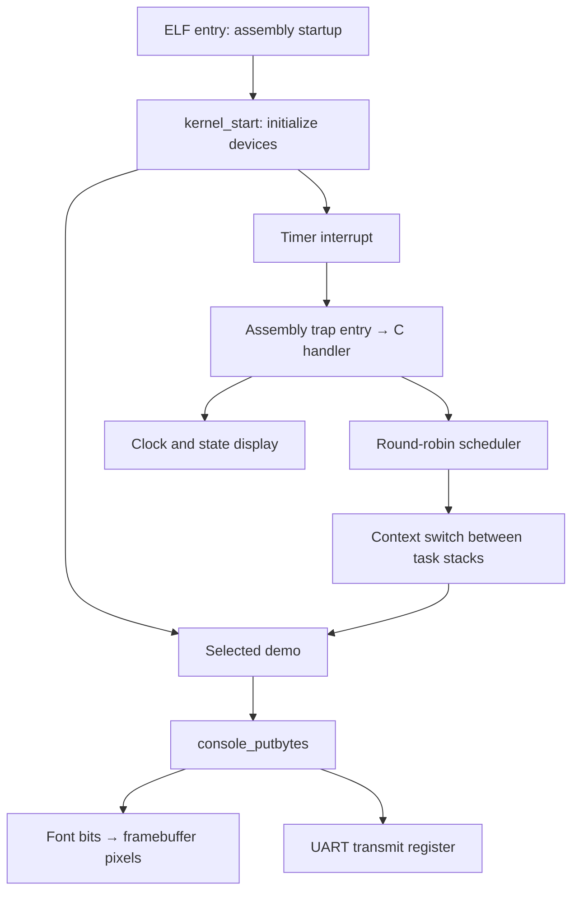

# 1. Kernel overview

This is a small freestanding RISC-V kernel written in C and assembly. It runs on one RV64 hart in machine mode, draws a graphical text console, sends UART output, and schedules tasks with timer interrupts.

The default **CEP** platform has a 1280 × 720 framebuffer. The **`virt`** backend runs with standard QEMU and uses a serial console. Each platform has its own kernel address and UART driver; [QEMU and RISC-V](02-qemu-riscv.md) explains the difference.

## Architecture



Assembly handles startup, trap entry and context switching where explicit register control is necessary. C handles formatting, device access, task state and scheduling policy. Tasks share the kernel's memory and privileges.

## What to run

The commands below use local CEP tools configured in [Run and verify](08-run-and-verify.md). With Docker, use `./scripts/run-container.sh` followed by the demo name instead.

| Command | What it demonstrates | Recorded output |
| --- | --- | --- |
| `./run.sh` | Three tasks sleeping, waking and terminating while the clock runs | [Start](evidence/processes-start.png), [end](evidence/processes-end.png), [log](evidence/processes.txt) |
| `./run.sh DEMO=pixels` | Four colored rows of printable ASCII and automatic wrapping of a long paragraph | [Screen](evidence/pixels.png), [log](evidence/pixels.txt) |
| `./run.sh DEMO=console` | Newline, tab, backspace, carriage return and screen clearing | [Screen](evidence/console.png), [log](evidence/console.txt) |
| `./run.sh DEMO=scroll` | Scrolling after more text is written than fits on screen | [Screen](evidence/scroll.png), [log](evidence/scroll.txt) |
| `./run.sh DEMO=uart` | Direct serial output and text mirrored to the screen | [Screen](evidence/uart.png), [log](evidence/uart.txt) |
| `./run.sh DEMO=clock` | Timer interrupts with only `idle` running | [Screen](evidence/clock.png), [log](evidence/clock.txt) |

Close each QEMU instance before starting the next. `DEMO` selects a build configuration; it is not a command entered into a guest shell.

## Code map

| Component | Source | Responsibility |
| --- | --- | --- |
| Build and memory layout | [Makefile](../Makefile), [kernel.lds](../src/kernel.lds) | Select the platform, compile objects and place ELF sections |
| Startup | [crt0.S](../src/crt0.S), [start.c](../src/start.c) | Set `gp` and `sp`, clear `.bss`, initialize devices and select the demo |
| Platform constants | [cep_platform.h](../src/cep_platform.h) | Device addresses, timer frequency and register fields |
| Graphical console | [console.c](../src/console.c), [font.c](../src/font.c) | Pixels, 8 × 8 characters, cursor, control bytes and scrolling |
| Serial output | [uart.c](../src/uart.c), [console_serial.c](../src/console_serial.c) | Polling UART transmission and the `virt` console backend |
| Timer and traps | [time.c](../src/time.c), [traitant.S](../src/traitant.S) | Program deadlines, preserve interrupted registers and dispatch the timer interrupt |
| Task management | [processus.c](../src/processus.c), [processus.h](../src/processus.h) | Creation, identity, round-robin selection, sleep and exit |
| Context switching | [ctxt.S](../src/ctxt.S) | Save and restore the task's stack pointer, return address and machine context |
| Examples | [demos.c](../src/demos.c), [test_student.c](../src/test_student.c) | Exercise individual devices and the complete task lifecycle |
| Host-side verification | [test_qemu.py](../scripts/test_qemu.py), [capture_evidence.py](../scripts/capture_evidence.py) | Run kernels, check output and capture the actual framebuffer |

## Task lifecycle

The fixed table has four slots: `idle` and three other tasks. Each task has a name, PID, state, saved context and stack storage. A normal task reserves a 32 KiB stack; `idle` continues on the 16 KiB boot stack.

| State | Value | Scheduler behavior |
| --- | --- | --- |
| `RUN` | 0 | Task currently executing |
| `RUNNABLE` | 1 | Eligible for the next turn |
| `WAIT` | 2 | Skipped until its sleep deadline is reached |
| `DIE` | 3 | Finished or unused; skipped |

`cree_processus` prepares a task for its first turn. `dors` saves a wakeup deadline and yields. `fin_processus` ends a task; `proc_launcher` also calls it when the task function returns. The timer invokes the scheduler at a nominal 20 Hz, while the visible clock updates once per second. See [Processes](07-processes.md) for the register layout and switching sequence.

## Limits

- One hart, four task slots, no priorities and no reuse of terminated slots.
- Shared memory and M-mode privileges; no user-mode isolation, paging setup or stack-overflow checks.
- Sleep uses whole seconds derived from handled timer interrupts, so it is not a precise wall-clock delay.
- UART transmission is implemented. UART reception, keyboard input and a shell are not implemented.
- No filesystem, networking or system-call interface.

## Verify the behavior

```sh
sh scripts/course-env.sh make test
sh scripts/course-env.sh python3 scripts/capture_evidence.py
```

The integration test checks boot, formatting bounds, sleep, termination and timer preemption. The capture script runs the CEP examples and reads video memory through QMP. Screenshots show output; UART logs record transmitted bytes; the busy-loop test checks preemption. Use each for the behavior it can establish.

Start the implementation walkthrough at [Build the kernel step by step](09-development.md), or use [Run and verify](08-run-and-verify.md) for installation and evidence collection.
