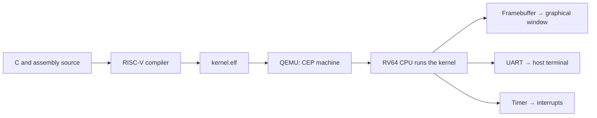

# 2. QEMU, RISC-V and the CEP machine

Three components work together: the compiler creates RISC-V instructions, QEMU executes them on an emulated machine, and the kernel controls that machine's devices.



Your computer's Linux runs QEMU. Inside the emulated machine, this project is the kernel: there is no guest Linux or disk image containing installed applications. The native compiler on an x86-64 computer would produce the wrong instructions, so the build uses `riscv64-unknown-elf-gcc`.

## RISC-V describes the CPU interface

An **instruction set architecture**, or ISA, defines instructions, registers and their behavior. RV64I provides 64-bit integer registers. This project also enables multiplication/division, atomic instructions and control-register access. [Official RV64I specification](https://docs.riscv.org/reference/isa/v20260120/unpriv/rv64.html).

The [Makefile](../Makefile) selects:

| Option | Meaning here |
| --- | --- |
| `-march=rv64ima_zicsr` | RV64 integer base, M and A extensions, and CSR instructions |
| `-mabi=lp64` | Calling convention with 64-bit `long` and pointers; 32-bit `int` |
| `-mcmodel=medany` | Addressing model suitable for the selected kernel locations |
| `-ffreestanding -nostdlib` | The kernel supplies startup code and runtime support |
| `-g` | Debug information for GDB |

A **hart** is a hardware execution thread. QEMU runs with `-smp 1`, so tasks take turns on one hart. Enabling the A extension does not make the scheduler multicore: it protects shared state by disabling interrupts on that single hart.

The original toolchain accepts `rv64ima`; its assembler predates the explicit Zicsr spelling used by modern tools. [course-env.sh](../scripts/course-env.sh) selects that spelling. Instructions such as `csrr` and `csrw` still access control and status registers, or **CSRs**. See the [Zicsr specification](https://docs.riscv.org/reference/isa/v20260120/unpriv/zicsr.html) and [RISC-V ABI](https://riscv-non-isa.github.io/riscv-elf-psabi-doc/).

## QEMU supplies the machine

`qemu-system-riscv64` emulates a complete system: CPU, memory and peripherals. `-machine` chooses the device layout. See [QEMU's RISC-V system emulator](https://www.qemu.org/docs/master/system/target-riscv.html).

The graphical launch command uses these options:

| Option | Effect |
| --- | --- |
| `-machine cep` | Select the course's custom machine |
| `-bios none` | Skip the default firmware |
| `-kernel build/cep/kernel.elf` | Load the kernel executable |
| `-m 32M -smp 1` | Configure 32 MiB of memory and one hart |
| `-display sdl,show-cursor=on` | Open the framebuffer window |
| `-serial mon:stdio` | Connect UART and the QEMU monitor to the host terminal |

QEMU displays the framebuffer, but [console.c](../src/console.c) draws the pixels and characters. The terminal's QEMU monitor controls the emulator; it is not a shell implemented by the kernel.

## CEP and `virt` have different memory maps

**CEP** is the original course platform, available in its custom QEMU build. **`virt`** is an additional port for standard QEMU, using a serial console in this repository. Its devices are described in the [official `virt` documentation](https://www.qemu.org/docs/master/system/riscv/virt.html).

| Resource | CEP | `virt` |
| --- | --- | --- |
| Kernel base | `0x1000` | `0x80000000` |
| UART | SiFive at `0x10013000` | NS16550 at `0x10000000` |
| Graphics in this project | Framebuffer at `0x80000000` | Serial console only |
| Hart 0 `mtime` / `mtimecmp` | `0x0200bff8` / `0x02004000` | Same addresses used by the port |
| Run | `./run.sh` | `make PLATFORM=virt run` |

These addresses come from [cep_platform.h](../src/cep_platform.h), [uart.c](../src/uart.c) and the Makefile. The kernel assumes this layout; it does not discover devices dynamically.

**`0x80000000` is video memory on CEP and kernel RAM on `virt`.** Changing QEMU's machine argument alone cannot switch platforms: the build must select both the correct link address and the correct drivers.

## Try it

From the repository root, list the machines supported by the course QEMU:

```bash
sh scripts/course-env.sh sh -c '"$QEMU" -machine help'
```

Find `cep`, then run:

```bash
./run.sh
```

Watch the graphical window and the terminal. `console_putbytes` sends text to both the framebuffer driver and UART. The [UART chapter](05-uart.md) separates these paths experimentally.

For installation and the standard-QEMU alternative, follow the [reproduction guide](08-run-and-verify.md). Continue with [the boot sequence](03-boot-kernel.md).
