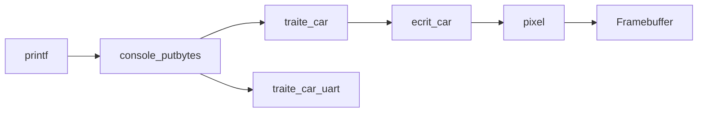

# 4. Pixels and console

Implementation: [console.c](../src/console.c), [console.h](../src/console.h) and [font.c](../src/font.c).

## Run a small example

```sh
./run.sh DEMO=pixels
```

Rows 1–4 each show all 95 printable ASCII characters, from space (32) through `~` (126), including punctuation. The rows are red, green, blue and white, using the normal 8 × 8 font. The screen stays static.

A 1,602-character paragraph follows the colored rows. It passes through `console_putbytes` as one string without newline bytes. The console automatically starts a new row after 160 characters; it wraps by character, so a word can cross the right edge.

Compare the [framebuffer capture](evidence/pixels.png) with the [UART log](evidence/pixels.txt). The long paragraph wraps on screen even though the string contains no explicit line breaks.

## From coordinates to an address

CEP exposes its framebuffer at `0x80000000`. It has 1280 columns, 720 rows and four bytes per pixel:

```text
index   = y * 1280 + x
address = 0x80000000 + 4 * index
```

In C, adding an index to a `uint32_t *` already multiplies it by four:

```c
volatile uint32_t *address =
    (volatile uint32_t *)ADRESSE_INITIAL + column + ligne * DISPLAY_WIDTH;
*address = couleur;
```

This is the essential operation in `pixel`. `volatile` keeps the device access observable. The function checks coordinates before writing so an invalid position cannot write beyond video memory.

The framebuffer occupies 3,686,400 bytes. These addresses belong to CEP: on `virt`, `0x80000000` is kernel RAM, so the two platforms need different backends.

## From font bits to a character

`font8x8_basic` contains eight bytes per character. Each byte is one row; each bit is a pixel. For `A`, the table contains:

```text
byte    pixels, bit 0 on the left
0x0c    ..##....
0x1e    .####...
0x33    ##..##..
0x33    ##..##..
0x3f    ######..
0x33    ##..##..
0x33    ##..##..
0x00    ........
```

`ecrit_car(row, column, 'A')` reads those bits and calls `pixel` for each set bit. Text coordinates are converted with `x = column * 8 + bit` and `y = row * 8 + font_row`.

Watch the argument order: `pixel(column, row, color)` uses pixel coordinates; `ecrit_car(row, column, character)` uses text cells. `ecrit_car` draws white. The color example follows the same short bitmap loop with a selected color; it does not change the console API.

There are 160 text columns and 90 physical text rows. Row 0 holds the clock and process states; regular output starts at row 1.

## From `printf` to the screen



`traite_car` handles both printable characters and control bytes:

| Input | Effect |
| --- | --- |
| Printable ASCII | Draw the character and advance the cursor |
| `\n` | Next line, column 0 |
| `\r` | Column 0 of the current line |
| `\b` | Move back one column when possible |
| `\t` | Next multiple of eight columns, wrapping at the right edge |
| `\f` | Clear the display and move the cursor to row 1, column 0 |

Try `./run.sh DEMO=console` and compare the [capture](evidence/console.png) with its [log](evidence/console.txt). The code uses short strings such as `AB\bC` and `ABC\rZ`, so the result can be followed character by character.

`place_curseur` moves the underline cursor. `efface_char` clears a cell before overwriting it. Calling `ecrit_car` alone only draws the set font bits; it does not clear the cell first. The font and driver handle ASCII bytes, not Unicode text.

## Scrolling

```sh
./run.sh DEMO=scroll
```

After writing 100 numbered lines, [the capture](evidence/scroll.png) shows lines 12 through 99. [The log](evidence/scroll.txt) contains all 100.

`defilement` uses `memmove` to shift the text area up by eight pixel rows, leaves row 0 in place and clears the last row. Source and destination overlap, which is why this operation needs `memmove`.

A useful exercise is to change one test string, predict the cursor position, run it, and compare. The examples and capture script provide observations; the screenshots do not prove every possible coordinate or control-byte sequence.
