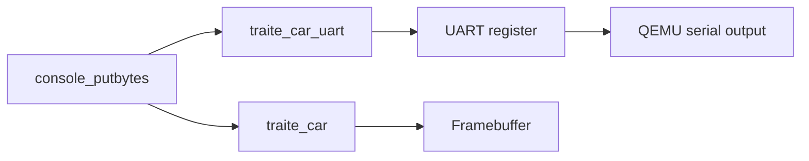

# 5. UART output

Implementation: [uart.c](../src/uart.c), with hardware definitions in [cep_platform.h](../src/cep_platform.h).

UART means *Universal Asynchronous Receiver/Transmitter*. Here the kernel writes device registers, and QEMU delivers the transmitted bytes to a terminal or file. The implemented direction is **TX**, transmission. RX definitions exist in the headers, but keyboard input is not implemented.

## Compare two output paths

```sh
./run.sh DEMO=uart
```

The example sends `UART_ONLY` directly through `traite_car_uart`, then writes `CONSOLE_MIRROR` through `console_putbytes`.

Compare the [screen](evidence/uart.png) with the [serial log](evidence/uart.txt): the direct message only appears in the log; the console message appears in both. This is the same output mechanism used by the process demonstration.



## Registers and initialization

CEP uses a SiFive-style UART at `0x10013000`. Its registers are 32-bit words:

| Register | Word index | Byte offset | Use |
| --- | --- | --- | --- |
| `txdata` | 0 | `0x00` | Transmit a byte; check FIFO full |
| `rxdata` | 1 | `0x04` | Not read by this driver |
| `txctrl` | 2 | `0x08` | Enable transmission |
| `rxctrl` | 3 | `0x0c` | Unused |
| `ie`, `ip` | 4, 5 | `0x10`, `0x14` | UART interrupts unused |
| `div` | 6 | `0x18` | Baud-rate divider |

With a 32 MHz UART clock and 115200 baud, the integer divider is `32000000 / 115200 - 1 = 276`. This is the UART signaling rate, not the CPU frequency or the timer-interrupt rate. The register layout and divider agree with the [OpenSBI SiFive driver](https://github.com/riscv-software-src/opensbi/blob/master/lib/utils/serial/sifive-uart.c).

`kernel_start` calls `init_uart` before printing. Initialization writes the divider to `div` and enables transmission through `txctrl`.

## Sending a byte

```c
while (uart[0] & 0x80000000U) { }
uart[0] = (uint8_t)c;
```

Bit 31 indicates a full transmit FIFO. The loop waits for space, then writes a byte. This is *polling*. Device accesses use `volatile`; there is no interrupt-driven output queue.

`console_putbytes` disables interrupts while writing its buffer. That prevents a timer switch within this output operation, at the cost of delaying interrupt handling while it runs.

## QEMU and the host terminal

The graphical launcher uses `-serial mon:stdio`. The UART and QEMU monitor share the terminal; monitor commands belong to the emulator, not to a shell in this kernel. The capture script uses `-serial file:<path>` instead. [QEMU invocation reference](https://www.qemu.org/docs/master/system/invocation.html).

To run the same CEP example without a window:

```sh
sh scripts/course-env.sh make DEMO=uart run-serial
```

The `virt` port uses a different device: an NS16550A at `0x10000000`, accessed as bytes. The build selects the driver for the chosen platform. Both backends implement transmission only.
