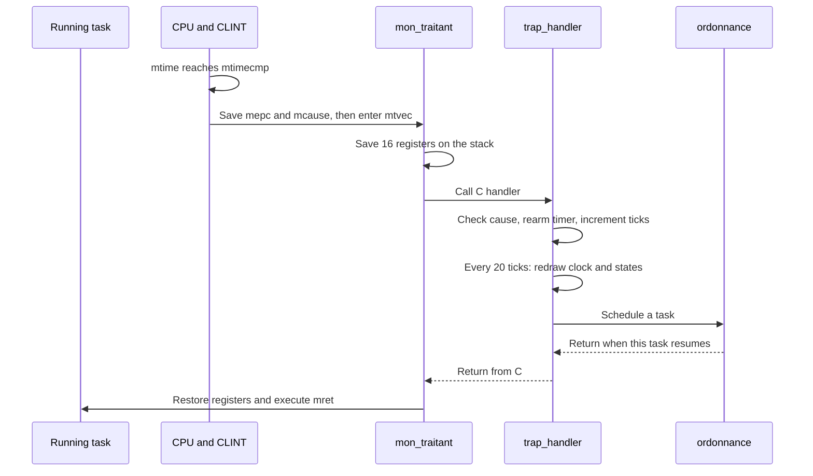

# 6. Clock and timer interrupts

The clock in the screen's corner and task scheduling share the same source: a periodic timer interrupt. It can interrupt a task even when that task never calls the scheduler voluntarily.

## Run the clock on its own

```bash
./run.sh DEMO=clock
```

`clock_demo` in [demos.c](../src/demos.c) initializes only `idle`, installs the handler and enables the timer. Watch the clock advance and compare the [serial output](evidence/clock.txt) with the framebuffer capture:


This small demo uses the existing timer API. The screenshot shows its visible output; GDB and the preemption test below examine the mechanism behind it.

## Three different time scales

| Name | Value | Meaning |
| --- | --- | --- |
| `TIMER_FREQ` | 10,000,000 per second | Assumed frequency of the hardware counter `mtime` |
| `ITFREQ` | 20 per second | Nominal interrupt frequency selected by the kernel |
| `nbr_secondes()` | `ticks / 20` | Whole seconds derived from handled interrupts |

The 10 MHz timer frequency is **not the CPU instruction frequency**. Each interrupt is scheduled 500,000 timer increments ahead: `10,000,000 / 20`, or 50 ms nominally.

[programme_timer](../src/time.c) writes the next deadline:

```c
*((volatile uint64_t *)CLINT_TIMER_CMP) =
    *((volatile uint64_t *)CLINT_TIMER) + TIMER_FREQ / ITFREQ;
```

These pointers address device registers. `volatile` requires actual accesses even though ordinary C code does not change the counter.

## Memory-mapped registers and CSRs

`mtime` and `mtimecmp` are accessed through memory. The remaining registers below are CPU **control and status registers**, accessed with instructions such as `csrr` and `csrw`.

| Register | Address or field | Role |
| --- | --- | --- |
| `mtime` | `0x0200bff8` | Current hardware timer count |
| Hart 0 `mtimecmp` | `0x02004000` | Deadline for the next interrupt |
| `mtvec` | CSR | Address of `mon_traitant` |
| `mie.MTIE` | Bit 7 | Enable machine timer interrupts |
| `mstatus.MIE` | Bit 3 | Global interrupt enable in M-mode |
| `mstatus.MPIE` | Bit 7 | Previous interrupt-enable state, used on trap return |
| `mcause` | Bit 63; cause code 7 | Identify an RV64 machine timer interrupt |
| `mepc` | CSR | Address at which interrupted execution will resume |

When `mtime >= mtimecmp`, the timer interrupt becomes pending. The enable bits allow the CPU to take it. Writing a future comparison removes that condition. The top bit of `mcause` distinguishes an interrupt from an exception; cause 7 identifies the machine timer. See the [RISC-V machine-mode specification](https://docs.riscv.org/reference/isa/v20260120/priv/machine.html).

The memory addresses are platform constants in [cep_platform.h](../src/cep_platform.h), not variables allocated by the linker.

## Setup and interrupt handling

The boot sequence first prepares the process table, installs `mon_traitant` with `init_traitant_timer`, and creates any demonstration tasks. `enable_timer()` then programs the deadline, enables `mie.MTIE`, and enables `mstatus.MIE`. This prevents an interrupt from reaching an uninitialized scheduler.



[traitant.S](../src/traitant.S) saves `ra`, `a0..a7` and `t0..t6`: 16 eight-byte registers, or **128 bytes**. These values must survive an asynchronous interruption even though C functions may overwrite them.

If `ordonnance` switches tasks, this handler invocation remains suspended on the old task's stack. When that task is selected again, it finishes the handler and executes `mret`. [Context switching](07-processes.md) explains the additional saved state.

`trap_handler` accepts only the expected timer cause. Other causes print `PANIC` with `mcause`, `mepc` and `mtval`, then halt normal execution.

## From ticks to `hh:mm:ss`

`handle_time_interrupt()` rearms the timer, increments `ticks`, updates the clock and task states every 20 ticks, and calls `ordonnance()` **on every tick**. Scheduling therefore has a nominal 50 ms interval while the clock display changes once per second.

On CEP, [ecrit_car_en_haut](../src/console.c) draws eight characters at the top right, such as `00:00:03`. Hours wrap modulo 100. The `virt` port has no graphical overlay.

This is a count of **handled interrupts**, rather than a direct conversion of elapsed `mtime`. Each deadline is also relative to the time when the handler rearms it. Delayed handling and periods with interrupts disabled can therefore make the displayed clock fall behind the hardware counter.

`nbr_secondes()` rounds down. For example, `dors(2)` at kernel time 0.9 s schedules a wakeup at whole second 2, not necessarily 2.9 s. Sleep deadlines use this discrete clock; they do not guarantee two continuous seconds of waiting.

## Inspect the timer in GDB

In terminal 1:

```bash
sh scripts/course-env.sh make DEMO=clock debug
```

In terminal 2:

```bash
gdb-multiarch build/cep-clock/kernel.elf
```

At the GDB prompt:

```gdb
target remote localhost:1234
break trap_handler
continue
print/x $mcause
print/x $mepc
print/x $mie
print/x $mstatus
x/gx 0x0200bff8
x/gx 0x02004000
```

Expect **`mcause = 0x8000000000000007`** and timer enable bit `mie & 0x80`. `mepc` depends on the interrupted instruction. Inside the handler, `mstatus.MIE` is cleared: trap entry saves its previous value in `MPIE` for return. This does not indicate a failed timer setup.

The [recorded session](evidence/timer-gdb.txt) shows the first interrupt before rearming the comparison. GDB pauses execution, so use this inspection to understand register state, not to measure normal timing accuracy.

The clock output demonstrates progression; the [busy-loop preemption test](07-processes.md#prove-preemption) demonstrates that another task can run without the active task yielding. The original project already contained the timer and scheduler connection; RV64 cause handling and interrupt-state preservation were corrected during recovery.
