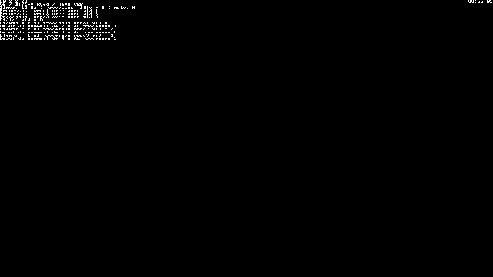
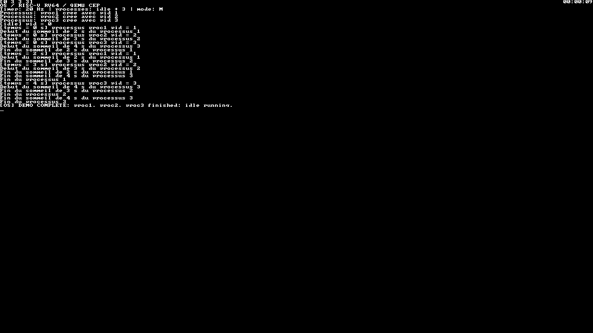
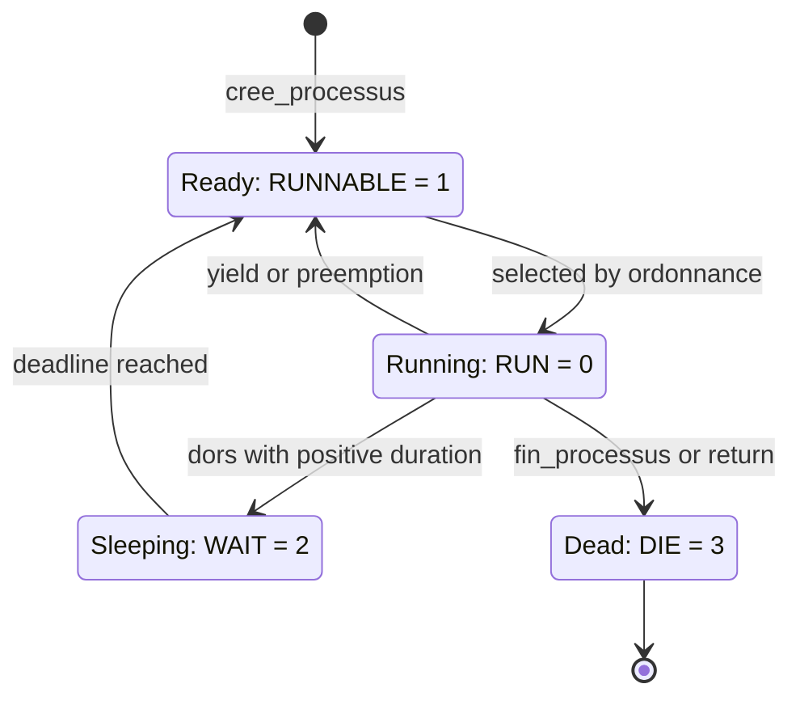
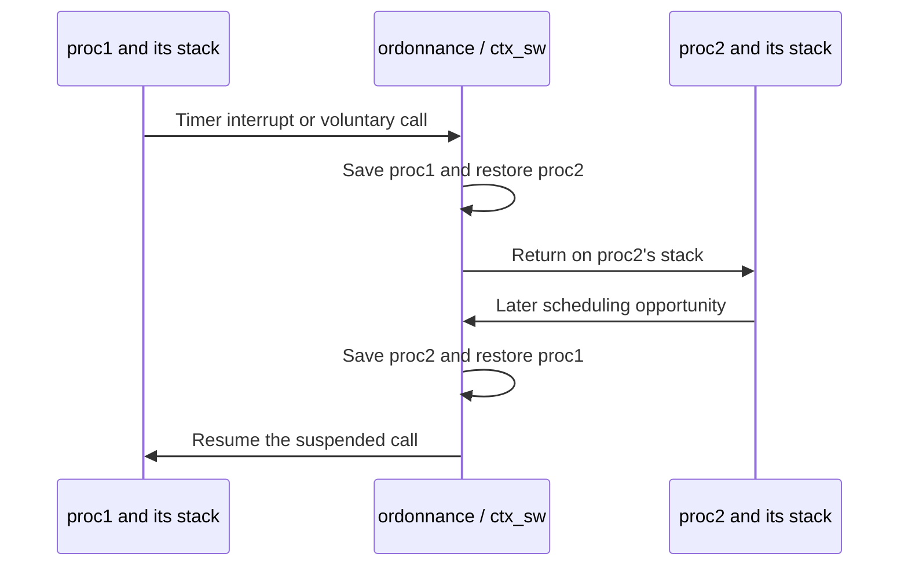

# 7. Processes: create, switch, sleep and exit

Three C functions take turns on one hart. Each keeps its own stack and continuation point; the scheduler chooses which receives the CPU. The course calls these tasks **processes**, but they share kernel memory and M-mode privileges. There is no process isolation or system-call boundary.

## Run the complete demo

```bash
./run.sh
```





Use the [serial log](evidence/processes.txt) to follow events between these captures. [test_student.c](../src/test_student.c) defines:

| Task | PID | Work | Exit path |
| --- | --- | --- | --- |
| `idle` | 0 | Wait for interrupts with `wfi` | Stays active |
| `proc1` | 1 | Print and sleep 2 s, twice | Return from its function |
| `proc2` | 2 | Print and sleep 3 s, twice | Call `fin_processus()` |
| `proc3` | 3 | Print and sleep 4 s, twice | Return from its function |

The second messages normally appear around kernel seconds 2, 3 and 4; tasks finish around seconds 4, 6 and 8. `DEMO COMPLETE` reports that all three finished. The window stays open: `idle` and the clock continue.

## The task record

[processus.h](../src/processus.h) defines `processus_t`:

| Field | Purpose |
| --- | --- |
| `pid`, `name[32]` | Identify the task |
| `state` | Running, ready, sleeping or dead |
| `reg[18]` | Saved context for the assembly switch |
| `pille[4096]` | Stack of 64-bit words |
| `hour_wake_up` | Wakeup deadline in whole kernel seconds |
| `temp_sommeil` | Requested sleep duration used in messages |

Each stack reserves **32 KiB**, aligned to 16 bytes. There are **four slots including `idle`**, allowing three other tasks. Allocation is static.

`idle` keeps using the **16 KiB boot stack**. Its table entry contains a reserved stack like every other entry, but its saved `sp` points to the boot stack it was already using.

## Creation prepares a future call

[cree_processus](../src/processus.c) rejects invalid arguments or a full table with `-1`. Otherwise it clears a slot, assigns the PID and name, prepares the stack and context, marks the task `RUNNABLE`, and returns its PID. The task function has not run yet.

The new context includes:

```text
reg[0]  = proc_launcher address
reg[1]  = top of the task stack
reg[5]  = task function address, such as proc1
reg[17] = initial mstatus
```

On restoration, `ctx_sw` loads `reg[5]` into `s1`, then copies it to argument register `a0`. Its `ret` uses the prepared `ra`, entering `proc_launcher` on the new stack.

The launcher enables interrupts and calls the task function. If it returns, the launcher calls `fin_processus`. This handles the implicit exits of `proc1` and `proc3`.

## Read the state display

| Value | State | Meaning |
| --- | --- | --- |
| 0 | `RUN` | Currently active |
| 1 | `RUNNABLE` | Ready to be selected |
| 2 | `WAIT` | Sleeping until its deadline |
| 3 | `DIE` | Finished or unused slot |

The display lists states by PID. `[0 2 2 2]` means `idle` is active and all three tasks sleep. `[0 3 3 3]` means all three finished. It refreshes once per second, before that tick's scheduling decision, so it can lag behind the latest serial messages.



`idle` is special: `dors` does not put it to sleep, and it cannot exit. It remains available when the other tasks cannot run.

## Round-robin scheduling

[ordonnance](../src/processus.c) first wakes tasks whose deadlines have passed. If the active task was `RUN`, it becomes `RUNNABLE`. The scheduler then searches circularly from the next PID, skipping `WAIT` and `DIE` entries:

```text
idle → proc1 → proc2 → proc3 → idle → ...
```

The search includes the old task at the end of the cycle. If it selects that same task, no context switch is needed. There are no priorities, and `idle` participates in the same circular order.

The timer requests scheduling every 50 ms nominally. A task may sleep or exit sooner, and disabled interrupts can delay the next decision; this is not a guaranteed 50 ms execution slice.

## Switching stacks switches continuations

[ctx_sw](../src/ctxt.S) receives pointers to the old and new contexts in `a0` and `a1`. It saves one context, restores the other, and returns using the **next task's stack and return address**.

| `reg[]` index | Saved value |
| --- | --- |
| 0 | `ra`: return address |
| 1 | `sp`: stack pointer |
| 2–3 | `gp`, `tp` |
| 4–15 | `s0..s11`: callee-saved registers |
| 16 | `mepc`: interrupted execution address |
| 17 | `mstatus`: machine state for resuming execution |

These 18 values occupy 144 bytes. The stack itself stays in memory; saving its pointer is enough to find it again.

For a timer-triggered switch, [traitant.S](../src/traitant.S) has also saved `ra`, `a0..a7` and `t0..t6` in a **128-byte interrupt frame**. C calls preserve `s0..s11`, while arguments and temporaries need that explicit interrupt protection. See the [RISC-V ABI](https://riscv-non-isa.github.io/riscv-elf-psabi-doc/).



Table updates and stack switching run with interrupts disabled. Each caller restores its previous interrupt state when it resumes. This protects the single-hart design; it would not provide a lock between multiple harts.

## Sleep and exit

`dors(n)` stores `nbr_secondes() + n`, marks the task `WAIT`, and schedules another task. Its saved context lets it return later. `dors(0)` yields without sleeping. The sleep-end message means the task became ready; it may still wait for its next turn. [Clock precision](06-clock-interrupts.md#from-ticks-to-hhmmss) explains the whole-second deadlines.

`fin_processus()` marks the task `DIE` and schedules away permanently. Returning to it is an error that triggers `PANIC`. Finished slots **are not reused**: after creating three tasks, further creation returns `-1` even if those tasks have exited. There is no dynamic stack reclamation.

## Prove preemption

The main demo calls `dors`, so it could run under a cooperative scheduler. Preemption needs a task that does not yield:

```bash
sh scripts/course-env.sh make test
```

With `KERNEL_SELFTEST`, `proc1` busy-loops for two kernel seconds without calling `dors`, `ordonnance` or `wfi`. `proc2` must execute during that interval. If the timer cannot interrupt the loop, the condition fails or the external test times out.

`SELFTEST: PREEMPT PASS` records that check. Other markers cover sleep and explicit/implicit exits. See the [self-test log](evidence/selftest.txt). `SLEEP PASS` and `PREEMPT PASS` can appear in either order; their conditions matter, not an arbitrary printing order.

## Inspect tasks in GDB

In terminal 1:

```bash
sh scripts/course-env.sh make debug
```

In terminal 2:

```bash
gdb-multiarch build/cep/kernel.elf
```

At the GDB prompt:

```gdb
target remote localhost:1234
break ordonnance
continue
print n_proc
print actif->pid
print actif->state
print table_des_processus[1].state
print table_des_processus[1].hour_wake_up
print/x table_des_processus[1].reg[1]
print/x &table_des_processus[1].pille[4096]
continue
```

At the first scheduler call, expect four tasks, active PID 0, and `proc1` ready with its saved `sp` equal to the top of its stack. The [recorded session](evidence/processes-gdb.txt) inspects these fields using QEMU without a window.

After a task has executed, its saved `sp` generally lies below the stack's top because of function calls and interrupt frames. Compare its state and deadline with the sleep messages.

The fixed table and circular policy make this implementation easy to inspect. Its limits are concrete: no priorities, slot reuse, memory isolation or stack-overflow checks. The [inventory](01-inventory.md) separates the original functionality from fixes to initialization, alignment and interrupt-state preservation.
