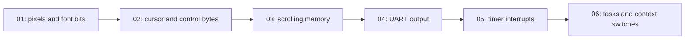
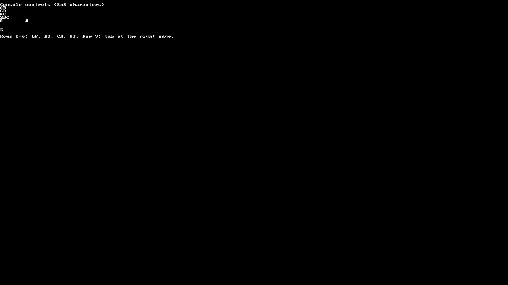

# 9. Build it step by step

Start with a small project, read its entry point, change one operation, then move to the next mechanism. The six numbered example folders are independent: each contains its own `src/main.c`, drivers, runtime, boot assembly, linker script, Makefile, launchers and `evidence/` directory.

Follow [Run and verify](08-run-and-verify.md) for the tools. Each command block below starts at the repository root. After entering a folder, `./run.sh` uses local CEP tools; `./scripts/run-container.sh` uses the pinned Docker toolchain. Copying an example folder elsewhere keeps all its build inputs together.



## 1. Draw pixels and characters

Start with the [01-pixels README](../examples/01-pixels/README.md), then open its [src/main.c](../examples/01-pixels/src/main.c):

```sh
cd examples/01-pixels
./run.sh
```

The entry point initializes the UART and console, creates a string of the 95 printable ASCII characters, and draws it in four colors. A long paragraph then goes through `console_putbytes` as one string with no newline bytes.

In the local [console.c](../examples/01-pixels/src/console.c), `pixel` checks coordinates and writes a 32-bit color to:

```text
0x80000000 + 4 * (y * 1280 + x)
```

`ecrit_car` reads eight rows of font bits from the local [font.c](../examples/01-pixels/src/font.c). Bit 0 is the leftmost pixel of each row. `color_text` uses that same bitmap at its normal 8 × 8 size, selecting red, green, blue or white ink. [Pixels and console](04-pixels-console.md) explains the address and bitmap calculations.


The display has 160 text columns. The 1,602-byte paragraph starts on row 6 and ends with the cursor at row 16, column 2. Wrapping occurs after column 159 and can split a word. Try changing one color word or inserting a character in the paragraph; rebuild and compare the result.

This first folder also makes the boot path small enough to follow. Its [Makefile](../examples/01-pixels/Makefile) lists the exact C and assembly sources. Its [kernel.lds](../examples/01-pixels/src/kernel.lds) places the ELF at `0x1000`. [crt0.S](../examples/01-pixels/src/crt0.S) disables interrupts, selects hart 0, initializes `gp` and `sp`, clears `.bss`, and calls `kernel_start`.

From inside `01-pixels`, inspect the executable:

```sh
sh scripts/course-env.sh make
sh scripts/course-env.sh sh -c '"${CROSS_COMPILE}readelf" -h -l build/cep/kernel.elf'
```

The [boot chapter](03-boot-kernel.md) applies the same sequence to the complete kernel and provides a GDB walkthrough.

## 2. Control the cursor and text output

Start with the [02-console README](../examples/02-console/README.md) and [main.c](../examples/02-console/src/main.c):

```sh
cd examples/02-console
./run.sh
```

The entry point is a sequence of short calls. Read them in order: clear the screen, print `AB` and `CD` on separate rows, replace a character with backspace, return to column zero, then test tab stops and a tab at the right edge.

The local [console driver](../examples/02-console/src/console.c) connects each byte to a cursor operation. `place_curseur` draws an underline at the current cell. `traite_car` interprets `\n`, `\r`, `\b`, `\t` and `\f`, or draws a printable glyph and advances. `ecrit_car` alone draws set font bits; the console clears a cell before replacing its contents.



Predict `AB\bC` before running it: backspace returns to the previous column, so the final text is `AC`. The `ABC\rZ` example leaves `ZBC`. Change one string, predict its cursor position and inspect the [UART output](evidence/console.txt) alongside the screen.

## 3. Scroll overlapping framebuffer rows

Start with the [03-scroll README](../examples/03-scroll/README.md) and [main.c](../examples/03-scroll/src/main.c):

```sh
cd examples/03-scroll
./run.sh
```

The main function draws a header at text row 0, then a single loop prints 100 numbered lines. The final [capture](evidence/scroll.png) shows lines 12 through 99; the [UART log](evidence/scroll.txt) retains all 100 lines.

Follow `defilement` in the local [console.c](../examples/03-scroll/src/console.c). It moves the text area upward by eight pixel rows with `memmove`, leaves row 0 in place and clears the last row with `memset`. The source and destination overlap, so the copying order matters. Try a smaller loop bound, then increase it until the first line scrolls away.

These first three projects contain no timer handler, process table or scheduler. Their finished screens remain still.

## 4. Separate UART transmission from drawing

Start with the [04-uart README](../examples/04-uart/README.md) and [main.c](../examples/04-uart/src/main.c):

```sh
cd examples/04-uart
./run.sh
```

The local [uart.c](../examples/04-uart/src/uart.c) polls the transmitter until it has room, then writes a byte to its memory-mapped register. The direct call sends `UART_ONLY` through the serial device. `console_putbytes` sends `CONSOLE_MIRROR` through both the graphical character path and UART.

Compare the [screen](evidence/uart.png) with the [serial log](evidence/uart.txt): the `UART_ONLY` message appears in the log, while `CONSOLE_MIRROR` also appears on screen. UART sends bytes; the console driver turns bytes into pixels. [UART output](05-uart.md) explains the registers and polling loop.

## 5. Advance a clock with interrupts

Start with the [05-clock README](../examples/05-clock/README.md) and [main.c](../examples/05-clock/src/main.c):

```sh
cd examples/05-clock
./run.sh
```

This project installs a timer handler, enables interrupts, and waits with `wfi`. There is no process table or scheduler: the interrupted main loop resumes after every handler.

The local [time.c](../examples/05-clock/src/time.c) programs `mtimecmp = mtime + TIMER_FREQ / ITFREQ`. With a 10 MHz counter and `ITFREQ = 20`, each deadline is nominally 500,000 increments, or 50 ms, away. This describes the timer counter, not the CPU instruction frequency.

`init_traitant_timer` writes the entry address of [mon_traitant](../examples/05-clock/src/traitant.S) into `mtvec`. The assembly handler saves registers, calls C, restores registers and executes `mret`. C rearms the deadline, increments `ticks` and redraws the clock every 20 ticks.


Observe `clock=0s`, `clock=1s`, `clock=2s` and `clock=3s` in the [log](evidence/clock.txt). The visible clock continues after capture. Delayed interrupt handling can make kernel seconds lag behind elapsed hardware time. Use the local README's GDB commands and [Clock and interrupts](06-clock-interrupts.md) to inspect the trap cause and timer registers.

## 6. Give tasks separate stacks and continuations

Start with the [06-processes README](../examples/06-processes/README.md) and [main.c](../examples/06-processes/src/main.c):

```sh
cd examples/06-processes
./run.sh
```

This entry point prepares the process table and trap vector, creates three tasks, then enables the timer. The task functions are in the same small `main.c`: they print their identity and sleep for 2, 3 and 4 kernel seconds, twice each. `idle` waits for interrupts and reports when all three have finished.

The local [processus.h](../examples/06-processes/src/processus.h) gives each table entry a PID, name, state, 18 saved registers and stack storage. `cree_processus` in [processus.c](../examples/06-processes/src/processus.c) prepares a stack pointer and a return address leading to `proc_launcher`. The new task becomes `RUNNABLE`; it begins executing when selected by the scheduler.

[ctx_sw](../examples/06-processes/src/ctxt.S) saves the current context and loads the next one. Its final `ret` uses the loaded return address and stack. The stack's bytes remain in memory; its saved `sp` locates the suspended call frames. Timer-driven switching also preserves a 128-byte interrupt frame on that stack.


Here the [timer handler](../examples/06-processes/src/time.c) calls `ordonnance` on every tick. The scheduler searches the fixed table circularly, skipping `WAIT` and `DIE` entries. `dors(n)` records a whole-second deadline and schedules another task; `dors(0)` yields without sleeping. At the deadline a task becomes ready, then waits for selection.

`fin_processus` marks the task `DIE` and schedules away permanently. Returning from a task reaches the same termination path through `proc_launcher`. Finished slots are not reused. Tasks share memory and machine-mode privileges.


Compare the [serial timestamps](evidence/processes.txt) with the state panel: `RUN = 0`, `RUNNABLE = 1`, `WAIT = 2`, `DIE = 3`. After termination the panel is `[0 3 3 3]`; `idle` and the clock keep running. [Processes](07-processes.md) explains the context layout, state transitions and scheduling limits.

The repository root provides the complete kernel with the same mechanisms. Its [src/main.c](../src/main.c) contains the entry point and task functions; run `./run.sh` from the repository root to start it.

## Verify the complete behavior

Run these commands from the repository root:

```sh
sh scripts/course-env.sh make test
sh scripts/course-env.sh python3 scripts/capture_evidence.py
```

`make test` builds the normal kernel and the independent [tests/kernel project](../tests/kernel/README.md). Its [main.c](../tests/kernel/src/main.c) checks bounded formatting, sleep, exit and preemption. A task that calls `dors` voluntarily yields, so the preemption check uses a busy loop: another task must run before that loop ends. Read the [self-test log](evidence/selftest.txt).

The capture script builds each numbered example, pauses QEMU, reads its actual framebuffer and saves PNGs and UART logs. By default the output goes into `build/evidence/`. The [report](evidence/report.json) records versions and hashes. To refresh both the central documentation samples and each example's own `evidence/` directory:

```sh
sh scripts/course-env.sh python3 scripts/capture_evidence.py \
  --output docs/evidence --update-examples
```

Screenshots show visible output; logs and debugger state answer questions about execution. Follow [Run and verify](08-run-and-verify.md) to reproduce those observations.
