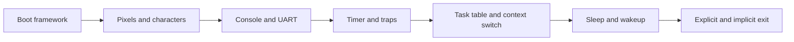

# 9. How the kernel was built

The project grew from a supplied boot framework into a graphical console and a small multitasking kernel. This timeline follows the original 2023 Git history described in the [inventory](01-inventory.md). Commit IDs below refer to those local historical repositories, not commits in this recovered repository.

The commands reproduce each mechanism with the **current** code. The separate `DEMO` examples and screenshots were added during recovery; they are not the original course tests.



## September 24, 2023: start from the framework

Sébastien Viardot's starting commit, `352e9f4`, supplied boot assembly, linker setup, device definitions, a bitmap font and support routines. This let the student work build on a known machine layout.

Follow [the boot chapter](03-boot-kernel.md): compile an ELF, inspect its entry address, then stop in `kernel_start` with GDB. Assembly prepares the machine state needed by C. Later, assembly also handles trap entry and context switching; C implements most device and scheduling logic.

## October 15: turn pixel writes into a console

Console work is visible in `41c8046`. The implementation builds several small operations on one another: `pixel` writes a color to video memory; `ecrit_car` reads bits from the supplied 8 × 8 font; cursor helpers position text; `traite_car` handles control bytes; `defilement` moves rows when the screen fills.

Run these in order, closing QEMU between examples:

```sh
./run.sh DEMO=pixels
./run.sh DEMO=console
./run.sh DEMO=scroll
```


In the pixel example, four colored rows expose the font's printable characters. A long string then exercises automatic wrapping through the original console API. Trace one character from `console_putbytes` to its framebuffer address in [Pixels and console](04-pixels-console.md), then compare the [control-character](evidence/console.png) and [scrolling](evidence/scroll.png) captures.

## October 29: add serial output and timer interrupts

Commit `4dddfe8` introduces UART transmission and timer work. Both use memory-mapped device registers: writing the UART transmit register sends a byte; writing `mtimecmp` sets the next timer deadline. CPU control registers install and enable the interrupt handler.

```sh
./run.sh DEMO=uart
./run.sh DEMO=clock
```

The first example separates direct serial output from output mirrored to the screen. The second runs the clock with only `idle`. Follow [UART](05-uart.md) for the transmit path and [Clock and interrupts](06-clock-interrupts.md) for the path through assembly, the C handler and back to interrupted execution.


The 10 MHz timer counter and the kernel's nominal 20 interrupts per second are different quantities. Counting handled interrupts produces whole seconds; the same interrupt path provides scheduling opportunities.

## November 26: preserve one task while another runs

`0df81eb` adds process creation and identity; `1b2c495` adds assembly context-switch work. A task needs more than a function pointer: its record holds a state, saved registers and a separate stack. `ctx_sw` saves one continuation and restores another.

The final scheduler, `ordonnance`, visits ready tasks in circular order. Timer interrupts can invoke it even when a task does not yield. Read [Processes](07-processes.md) alongside [processus.c](../src/processus.c) and [ctxt.S](../src/ctxt.S): follow the saved `sp`, then identify which task's return address `ret` uses.

The implementation uses a fixed table containing `idle` and three other tasks. They share memory and machine-mode privileges; a context switch does not create an isolated address space.

## December 2–3: let tasks wait and expose their states

`663e39f` on December 2 adds `dors`; `71e8380` on December 3 includes the process-state display. Sleeping records a deadline, changes the task to `WAIT`, and gives the CPU to another task. The scheduler changes it back to `RUNNABLE` when the deadline is reached.

```sh
./run.sh
```

Watch `proc1`, `proc2` and `proc3` sleep for 2, 3 and 4 seconds, twice each. Compare the displayed state digits with the [serial timestamps](evidence/processes.txt). The whole-second clock limits sleep precision; the clock chapter explains the rounding.

## December 14: finish the task lifecycle

`2a88ec3` adds implicit termination: `proc_launcher` calls the task function and routes its return to `fin_processus`. Thus `proc1` and `proc3` can return normally, while `proc2` calls the exit function explicitly. Finished tasks become `DIE`; their slots are not recycled.


The same day's keyboard-related commit, `6e90127`, contains an unfinished external-interrupt handler. The final commit, `3a1eac9`, adjusts timer/trap code. The [audit](01-inventory.md#the-keyboard-commit) found no working keyboard input path, so transmission and task management should not be mistaken for an interactive shell.

## 2026 recovery: make the result reproducible

Recovery kept these mechanisms and corrected startup initialization, task-table bounds, stack alignment, interrupt-state preservation, RV64 trap decoding and console bounds. The `virt` serial port, environment launchers, individual examples and automated checks were added separately.

```sh
sh scripts/course-env.sh make test
sh scripts/course-env.sh python3 scripts/capture_evidence.py
```

The tests check behavior, including preemption of a busy-looping task; the capture script reads actual CEP video memory and saves PNGs and UART logs. Use the [self-test log](evidence/selftest.txt) for scheduling checks and [capture report](evidence/report.json) for versions and hashes. The screenshots above show the recovered code running, not an archived 2023 execution.

Continue with [Run and verify](08-run-and-verify.md) to reproduce the environment and collect your own evidence.
