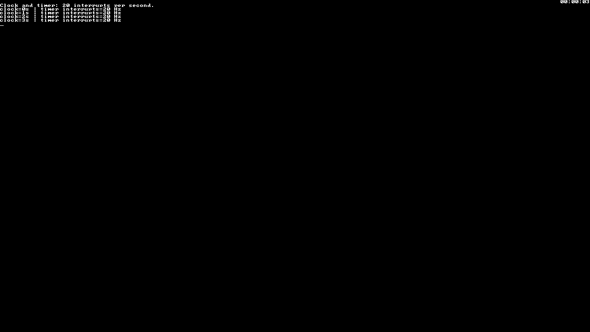
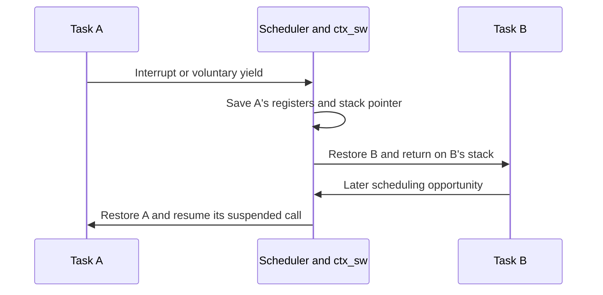

# 9. Build the kernel step by step

Work through the implementation from the first instruction to a complete task lifecycle. Each step introduces a mechanism, identifies its source files and gives a way to inspect it. Run the commands from the repository root with the [local CEP toolchain configured](08-run-and-verify.md#local-cep-toolchain). To run the graphical examples with Docker instead, use `./scripts/run-container.sh` followed by the demo name.


## 1. Establish memory and enter C

The [Makefile](../Makefile) compiles C and assembly into an ELF executable. [kernel.lds](../src/kernel.lds) places code, constants, initialized data and `.bss` at the selected platform's addresses. On CEP, the entry point is `0x1000`.

```sh
sh scripts/course-env.sh make
sh scripts/course-env.sh sh -c '"${CROSS_COMPILE}readelf" -h -l build/cep/kernel.elf'
```

Read [crt0.S](../src/crt0.S) from `entry`: disable interrupts, select hart 0, initialize `gp`, put `sp` at the top of the boot stack, clear `.bss`, then call `kernel_start`. This order gives C a valid stack and initialized globals before device or task code runs.

Check the ELF's entry address, then follow the [boot GDB session](03-boot-kernel.md) to stop in C and inspect `sp` and `gp`. Compare with the recorded [ELF headers](evidence/elf.txt) and [GDB output](evidence/boot-gdb.txt).

## 2. Write pixels, then characters

A framebuffer is memory that the display device reads as pixels. In [console.c](../src/console.c), `pixel` checks coordinates and writes a 32-bit color at:

```text
0x80000000 + 4 * (y * 1280 + x)
```

The `volatile` pointer makes each device write observable. `ecrit_car` adds one layer: it reads eight rows of font bits from [font.c](../src/font.c) and lights the corresponding pixels. An 8 × 8 font gives 160 text columns across the screen.

```sh
./run.sh DEMO=pixels
```


The static example draws printable ASCII in red, green, blue and white, then sends one long paragraph without newline bytes through `console_putbytes`. Follow the transition at column 159: the next character starts a new row. Wrapping is by character, so words can split across rows. [Pixels and console](04-pixels-console.md) traces the bitmap and address calculations.

## 3. Turn character drawing into output

Drawing a glyph alone does not decide where the next glyph belongs. `traite_car` maintains cursor position, interprets control bytes and advances after printable characters. `defilement` uses `memmove` because the source and destination overlap when rows move upward. Row 0 remains reserved for the clock and task states.

```sh
./run.sh DEMO=console
./run.sh DEMO=scroll
./run.sh DEMO=uart
```

Close QEMU between examples. Compare the [control-character capture](evidence/console.png), [scrolling capture](evidence/scroll.png) and [UART log](evidence/uart.txt).

[uart.c](../src/uart.c) polls the transmitter until it has room, then writes a byte to its memory-mapped register. On CEP, `console_putbytes` calls both the graphical character path and UART transmission. Direct `traite_car_uart` output reaches only the serial backend. This separation lets one string appear in a window and a host log without treating the UART as a graphics device. See [UART](05-uart.md).

## 4. Make time advance through interrupts

[time.c](../src/time.c) sets `mtimecmp = mtime + TIMER_FREQ / ITFREQ`. With a 10 MHz timer and `ITFREQ = 20`, each deadline is nominally 500,000 increments, or 50 ms, away. This is the timer's frequency, not the CPU instruction frequency.

Install [mon_traitant](../src/traitant.S) in `mtvec`, prepare the task table, then program and enable the timer. The table must exist because the C handler calls the scheduler. On each interrupt, assembly preserves registers, C updates the tick count and schedules, and `mret` eventually resumes interrupted execution.

```sh
./run.sh DEMO=clock
```



The demo uses only `idle`. Read [Clock and interrupts](06-clock-interrupts.md) to inspect `mcause`, `mepc`, `mie` and the timer registers in GDB. The handler redraws the clock every 20 ticks but calls the scheduler on every tick.

## 5. Give each task a resumable context

[processus.h](../src/processus.h) stores a PID, name, state, 18 saved registers and stack storage per task. `cree_processus` in [processus.c](../src/processus.c) prepares the stack pointer and a return address pointing to `proc_launcher`; creation makes a task ready rather than calling it immediately.

[ctx_sw](../src/ctxt.S) saves the current context and loads the next one. Its final `ret` uses the newly loaded stack and return address. The stack's bytes stay in memory; the saved `sp` lets the task find its suspended calls again. For timer-driven switching, the assembly trap handler also holds a 128-byte interrupt frame on that stack.



`ordonnance` searches the fixed table circularly, selecting `RUNNABLE` tasks and skipping sleeping or finished entries. Interrupts are disabled while shared scheduling state and the active stack change. This protects the single-hart implementation; tasks still share memory and machine-mode privileges.

## 6. Add waiting and termination

`dors(n)` stores a whole-second wakeup deadline, changes the task to `WAIT`, then schedules. The scheduler makes it `RUNNABLE` when the deadline is reached. Its context remains available for resumption. `dors(0)` yields without sleeping.

`fin_processus` instead sets `DIE` and schedules away permanently. `proc_launcher` calls it when a task function returns, so explicit exit and ordinary function return share the same termination path. There is no dynamic stack deallocation or reuse of dead slots.

```sh
./run.sh
```

The three tasks sleep for 2, 3 and 4 kernel seconds, twice each. Compare their [serial timestamps](evidence/processes.txt) with the state panel: `RUN = 0`, `RUNNABLE = 1`, `WAIT = 2`, `DIE = 3`.


After termination, `idle` remains active. See [Processes](07-processes.md) for the context layout, state transitions and GDB commands. Whole-second deadlines limit sleep precision; reaching a deadline also does not guarantee immediate selection by the scheduler.

## 7. Verify the mechanisms separately

```sh
sh scripts/course-env.sh make test
sh scripts/course-env.sh python3 scripts/capture_evidence.py
```

A demo that calls `dors` can progress by voluntarily yielding, so the integration test also uses a busy-looping task. Another task must execute while that loop runs, establishing timer preemption. The test checks sleep, exit and formatting bounds as well; inspect the [self-test log](evidence/selftest.txt).

The capture script pauses QEMU, reads the actual framebuffer, writes PNGs, and saves UART logs. The [report](evidence/report.json) records versions and hashes. Screenshots validate visible output; logs and debugger state answer different questions about execution. Follow [Run and verify](08-run-and-verify.md) to collect your own results.
