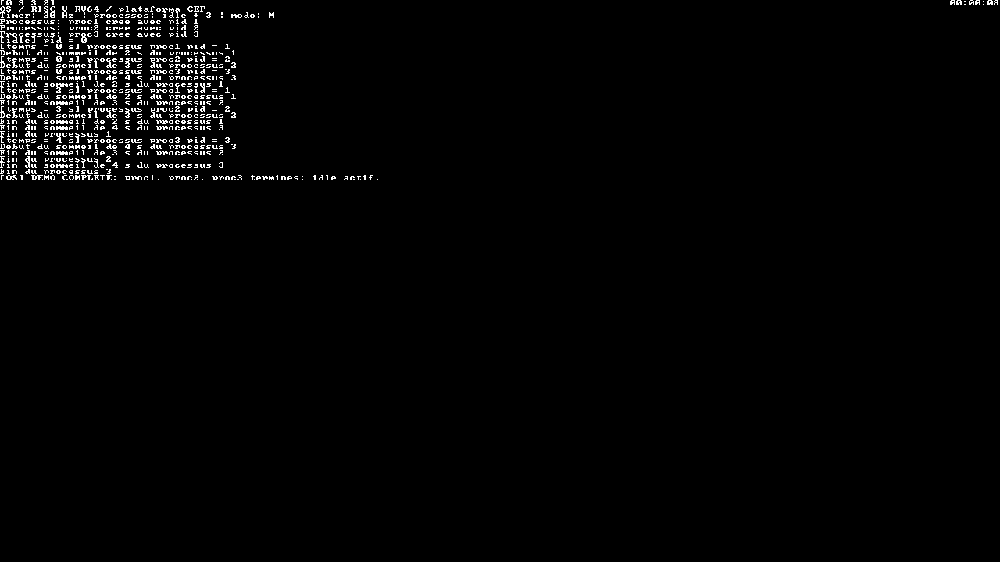

# Testes e validação

A validação desta versão é independente do avaliador da disciplina. Os badges antigos não foram usados como evidência de aprovação final: o código do avaliador escolar e seu ponto de entrada `entry_test` não estão na pasta recuperada.

## Executar os testes

```bash
make check
make test
```

`make test` compila dois ELFs separados: a demonstração normal em `build/virt/kernel.elf` e o kernel com `KERNEL_SELFTEST` em `build/virt-selftest/kernel.elf`. O script Python inicia cada um em um processo QEMU, captura a UART, procura os critérios de conclusão e encerra o emulador. O timeout padrão é 25 segundos por cenário; travamento, mensagem `PANIC` ou marcador ausente provocam falha.

| Verificação | Critério |
| --- | --- |
| Formato e entrada | ELF64 RISC-V com entrada em `0x80000000` para `virt` |
| Boot | Banner do kernel recebido pela UART |
| Criação | Cada uma das três tarefas aparece exatamente uma vez |
| Sono e despertar | Duas execuções por tarefa, separadas por pelo menos 2, 3 e 4 segundos do relógio do kernel |
| Ciclo de vida | Dois eventos de sono/despertar e um término por tarefa; retorno a `idle` |
| Preempção | Uma tarefa em busy-loop é interrompida pelo timer, permitindo executar outra sem ceder voluntariamente a CPU |
| Formatação limitada | `snprintf` preserva canário após truncamento, respeita buffer de um byte e aceita tamanho zero sem escrever |
| Término explícito e implícito | Tarefas atingem `DIE` tanto por `fin_processus()` quanto por retorno de função |

O autoteste termina com:

```text
SELFTEST: FORMAT PASS
SELFTEST: PREEMPT PASS
SELFTEST: SLEEP PASS
SELFTEST: EXIT PASS
SELFTEST: ALL PASS
```

As linhas de preempção e sono podem aparecer em ordem diferente. A saída completa também contém eventos do escalonador. Os logs ficam em `build/virt/qemu-demo.log` e `build/virt-selftest/qemu-selftest.log`.

## Resultado local da recuperação

A compilação e a execução foram verificadas no Ubuntu 24.04 usando as ferramentas históricas ainda presentes em `/matieres/4MMPCSEA/xinul`: **GCC 11.1.0** e **QEMU 6.2.50** customizado. O assembler antigo exige `RISCV_ARCH=rv64ima`; o padrão do repositório usa `rv64ima_zicsr` para a toolchain atual.

- A demonstração em `virt` terminou os três processos em aproximadamente 8 segundos.
- O autoteste em `virt` validou preempção, sono e término em aproximadamente 2 segundos.
- O backend `cep` compilou e executou a demonstração com os três processos até o retorno a `idle`.

A execução local do QEMU histórico precisou de um alias isolado para `libaio.so.1t64`, disponível no host x86-64. O wrapper opcional `scripts/course-env.sh` prepara esse alias no diretório de build quando necessário. Isso não instala bibliotecas nem altera os diretórios do sistema.

```bash
sh scripts/course-env.sh make check
sh scripts/course-env.sh make test
sh scripts/course-env.sh make PLATFORM=cep
```

Esses comandos são específicos de computadores que preservam o ambiente da disciplina. Para um computador novo, siga a instalação por pacotes no [guia de execução](getting-started.html).

## Registro visual da plataforma CEP



Captura dos pixels reais do framebuffer em `0x80000000`, obtida pela interface de monitoramento do QEMU e convertida para PNG. Mostra a saída da demonstração, o relógio e o painel de estados. O painel é atualizado uma vez por segundo; a captura pode anteceder sua próxima atualização após o término das tarefas.

## Integração contínua

O workflow `Kernel CI`, em `.github/workflows/ci.yml`, instala GCC RISC-V e QEMU padrão no Ubuntu 24.04, executa os testes e compila também o backend CEP. A execução do CEP precisa do emulador customizado, portanto não faz parte do runtime do runner padrão.

Outro job gera o site Jekyll para detectar erros na documentação antes da publicação. Os artefatos da execução incluem ELFs, mapas do linker, logs e o site gerado. Os resultados de cada commit podem ser consultados em [GitHub Actions](https://github.com/Raiagues/OS/actions).

## O que esta validação não afirma

Estes são testes de integração de um kernel didático, não uma prova de correção completa. A execução em `virt` não valida o desenho de pixels do CEP. A demonstração CEP verifica o caminho do sistema original, mas não reproduz toda a suíte gráfica de avaliação da disciplina.

Não há teste de hardware RISC-V físico, múltiplos harts, longas execuções, falta de memória ou isolamento de processos. A biblioteca C é reduzida e herdada do projeto; não oferece conformidade completa com uma libc de uso geral. O relógio conta ticks e o sono usa segundos inteiros; não é uma garantia de tempo real.

As correções feitas durante a recuperação estão descritas no [histórico](history.html), separadas do trabalho de 2023.
