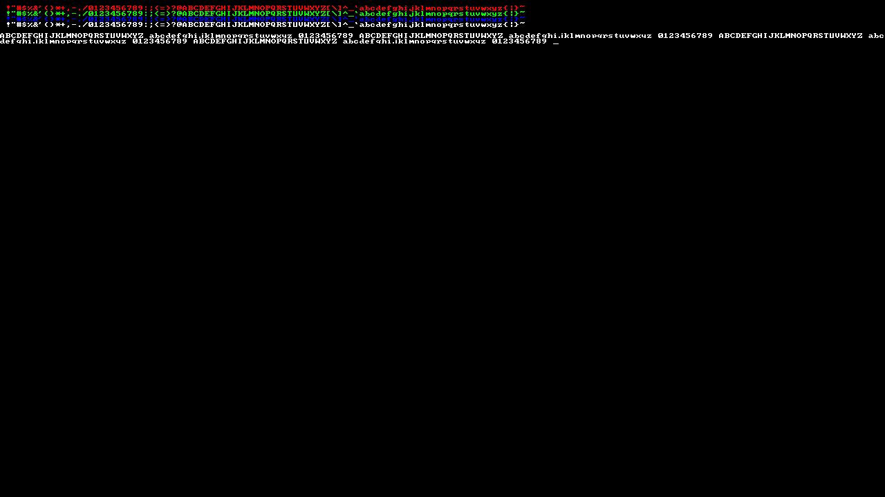

# 01 Pixels and characters

Write pixels to video memory, draw characters from an 8 × 8 bitmap font and
observe how the console wraps text at the right edge.

## Source files

| File | Role |
| --- | --- |
| [src/main.c](src/main.c) | Draws printable ASCII characters in four colors and a wrapping text sample |
| [src/console.c](src/console.c) | `pixel`, `ecrit_car`, cursor movement and `console_putbytes` |
| [src/console.h](src/console.h) | Framebuffer address and color constants |
| [src/font.c](src/font.c) | Bitmap data for the characters |
| [src/uart.c](src/uart.c) | Sends console bytes to the terminal |
| [src/crt0.S](src/crt0.S), [src/kernel.lds](src/kernel.lds) | Prepare the C entry point and load address |

## From a character to video memory


`pixel(x, y, color)` writes a 32-bit color. A row contains 1280 pixels, so:

```text
pixel index = y * 1280 + x
byte address = 0x80000000 + 4 * pixel index
```

In `console.c`, pointer arithmetic supplies the multiplication by four:

```c
volatile uint32_t *adresse = (volatile uint32_t *)ADRESSE_INITIAL
                            + column + ligne * DISPLAY_WIDTH;
*adresse = couleur;
```

Each byte in `font8x8_basic[character]` describes one row of eight pixels.
`color_text` shifts the byte and checks its low bit to decide whether to write
the selected color or black. `ecrit_car` performs the same font lookup for white
text. Character coordinates become pixel coordinates by multiplying by eight.

`kernel_start` draws ASCII values 32–126 on rows 1–4 in red, green, blue and
white. It then places the cursor at row 6 and writes a 63-byte sample four times
without a newline. The 252 characters occupy one full 160-character row and
92 columns of the next row. The cursor ends at row 7, column 92. Coordinates
start at zero.

The colored rows are drawn directly in the framebuffer. The wrapping sample
passes through `console_putbytes`, which also sends its bytes to UART.

## Build and run

From the repository root:

```sh
cd examples/01-pixels
sh scripts/course-env.sh make check
sh scripts/course-env.sh make
./run.sh
```

The scripts use the course tools at `/matieres/4MMPCSEA/xinul`: the RISC-V GCC
compiler and the custom QEMU with the CEP machine. The executable is
`build/cep/kernel.elf`. For another installation, set the directory explicitly:

```sh
COURSE_TOOLS=/path/to/xinul ./run.sh
```

To use Docker instead, run `./scripts/run-container.sh` in this folder.
It requires Linux x86_64, Docker, Xephyr, xauth and an X11 or XWayland desktop.
The Ubuntu/Debian packages are `docker.io`, `xserver-xephyr` and `xauth`.
Check `docker info`; the launcher obtains the course compiler/QEMU image on
first use. Both launch methods open the same activity. Close the window or
press Ctrl+C to stop.

To run without a window:

```sh
sh scripts/course-env.sh make run-serial
```

This still uses CEP; its graphics are offscreen. Exit with Ctrl+A, then X.
The normal QEMU installation does not include this course machine.

To save the serial output after building, use:

```sh
sh scripts/course-env.sh sh -c '
  "$QEMU" -machine cep -bios none -kernel build/cep/kernel.elf \
    -m 32M -smp 1 -display sdl -monitor none -serial file:build/uart.txt
'
```

The saved bytes are in `build/uart.txt`. The screenshots below show the CEP
framebuffer at 1280 × 720. Output was captured with the course GCC 11.1.0 and
QEMU 6.2.50 tools. All source and launch files needed by this activity are local
to this folder. [Attribution and licenses](../../README.md#credits).

## QEMU output



[Serial output](output/pixels.txt). The four colored rows are graphical output;
they are not transmitted as text. The screen remains static after drawing.
