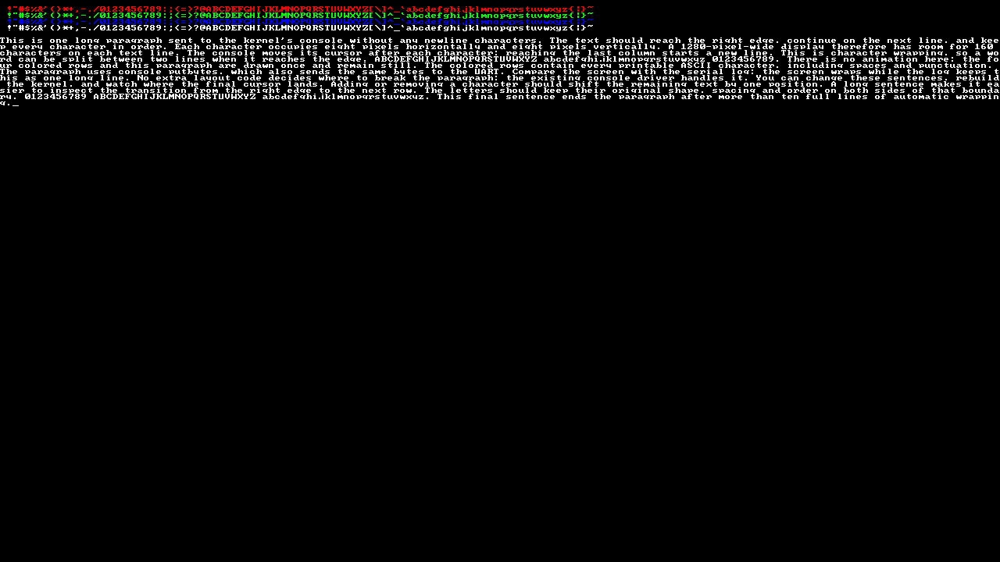

# 01 — Pixels, colors and wrapping

Draw every printable ASCII character in red, green, blue and white, then send one long paragraph through the console. The final screen stays still.

## Follow the code

1. `kernel_start` initializes the UART and clears the screen.
2. A loop fills `characters` with ASCII 32–126: space, punctuation, digits and both alphabets.
3. `color_text` draws the 95 characters at text rows 1–4. Each glyph occupies 8 × 8 pixels. White calls `ecrit_car`; the other colors send the same font bits to `pixel`.
4. `console_putbytes` receives one 1,602-byte paragraph with no newline bytes. Starting at row 6, it wraps after every 160 characters. The cursor ends at row 16, column 2; coordinates start at zero.
5. The example sends `EVIDENCE: PIXELS PASS` to UART and waits. That marker identifies the completed drawing.

A pixel at `(x, y)` occupies the 32-bit word at `0x80000000 + 4 * (y * 1280 + x)`. A font byte describes one row of eight pixels; bit 0 is the leftmost pixel.

Try changing one color word in `main.c`, or add one character to the paragraph and inspect the new cursor position. No font scaling or animation is involved.

## Recorded output



[UART output](evidence/pixels.txt) · [Capture report](evidence/report.json)

## Run with Docker

On Linux x86_64 with an X11 or XWayland desktop, install Docker, Xephyr and xauth. On Ubuntu/Debian, the package names are `docker.io`, `xserver-xephyr` and `xauth`. Docker must be running and accessible to your user; check with `docker info`.

From this folder:

```sh
./scripts/run-container.sh
```

The script downloads a pinned image containing the RISC-V compiler and CEP QEMU, compiles this project, and opens a 1280 × 720 window. UART output appears in the terminal. Close the window or press Ctrl+C to stop. The script accepts no example selector: this folder is the whole example.

## Run with local CEP tools

The graphical device belongs to QEMU's **CEP** machine. Standard QEMU packages do not include it. With the compiler and CEP QEMU installed under `/matieres/4MMPCSEA/xinul`, run:

```sh
sh scripts/course-env.sh make check
sh scripts/course-env.sh make
./run.sh
```

For another installation directory:

```sh
COURSE_TOOLS=/path/to/xinul ./run.sh
```

With separately configured tools, use explicit overrides:

```sh
make CROSS_COMPILE=/path/to/bin/riscv64-unknown-elf- \
     QEMU=/path/to/qemu-system-riscv64 RISCV_ARCH=rv64ima run
```

GCC 11 bundled with CEP uses `rv64ima`; newer compilers can use the default `rv64ima_zicsr`. `make` builds `build/cep/kernel.elf`. `BUILD=build/custom` changes the output directory. `make run-serial` keeps the framebuffer offscreen and prints UART output in the terminal; exit with Ctrl+A, X. `make clean` removes the selected build directory.

## Files to read

| File | Purpose |
| --- | --- |
| [src/main.c](src/main.c) | The complete example, starting at `kernel_start` |
| [src/console.c](src/console.c) | Pixel writes, characters, cursor, control characters and scrolling |
| [src/font.c](src/font.c) | The 8 × 8 bitmap font |
| [src/uart.c](src/uart.c) | Polling output to the CEP UART |
| [src/crt0.S](src/crt0.S) | Set up the boot stack, clear BSS, call C |
| [src/kernel.lds](src/kernel.lds) | Place the ELF at CEP address `0x1000` |
| [src/string.c](src/string.c) | The memory/string routines this example uses |
| `Makefile` | Explicit local sources and fixed CEP build |

Every source, header, linker script and launcher needed by this example is inside this folder. You can copy the folder elsewhere and build it there. The only external requirements are the host tools or Docker image. Interrupts stay disabled; this static example has no clock, process table or scheduler.

## Credits

Source notices are retained in the local files. The font credits Daniel Hepper, Marcel Sondaar and IBM and declares public-domain terms. The small runtime includes code with its own notices; see the source headers and [COPYING.GPL-2](COPYING.GPL-2).
