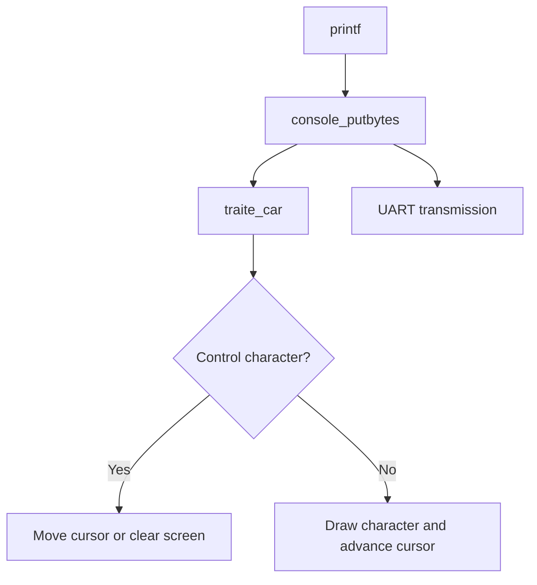
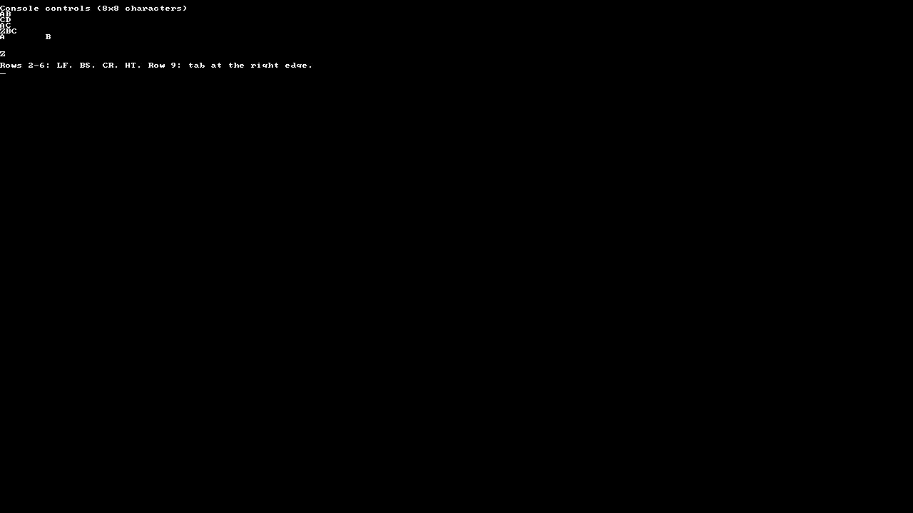

# 02 Console

Implement cursor movement and control characters on the framebuffer console.
The program writes short strings whose effect can be followed on the screen.

## Source files

| File | Role |
| --- | --- |
| [src/main.c](src/main.c) | Writes the strings and places the cursor for each case |
| [src/console.c](src/console.c) | `traite_car`, `place_curseur`, `efface_char` and `efface_ecran` |
| [src/printf.c](src/printf.c), [src/doprnt.c](src/doprnt.c) | Supplied formatting routines that call `console_putbytes` |
| [src/font.c](src/font.c) | Character bitmaps |
| [src/uart.c](src/uart.c) | Mirrors transmitted bytes to the terminal |

## Processing a character



`ligne_actuel` and `colonne_actuel` hold the cursor position in character cells.
`place_curseur` removes the old underline and draws it at the new position.
`efface_char` clears the current cell before another character is drawn there.

| String or byte | Expected effect |
| --- | --- |
| `AB\nCD\n` | Write AB and CD on separate lines |
| `AB\bC\n` | Move back over B and replace it with C: AC |
| `ABC\rZ` | Return to column 0 and replace A: ZBC |
| `A\tB\n` | Advance to the next tab stop before B |
| `\f` | Clear the screen and return to row 1, column 0 |

For example, the newline branch in `traite_car` is:

```c
case '\n':
    place_curseur(ligne_actuel + 1, 0);
    break;
```

The first argument selects the next text row; the second selects its first
column. In this activity, `main.c` also places the cursor at column 158 and
writes a tab followed by Z to show wrapping at the right edge.

## Build and run

From the repository root:

```sh
cd examples/02-console
sh scripts/course-env.sh make check
sh scripts/course-env.sh make
./run.sh
```

The scripts use the course tools at `/matieres/4MMPCSEA/xinul`: the RISC-V GCC
compiler and the custom QEMU with the CEP machine. The executable is
`build/cep/kernel.elf`. For another installation, set the directory explicitly:

```sh
COURSE_TOOLS=/path/to/xinul ./run.sh
```

To use Docker instead, run `./scripts/run-container.sh` in this folder.
It requires Linux x86_64, Docker, Xephyr, xauth and an X11 or XWayland desktop.
The Ubuntu/Debian packages are `docker.io`, `xserver-xephyr` and `xauth`.
Check `docker info`; the launcher obtains the course compiler/QEMU image on
first use. Both launch methods open the same activity. Close the window or
press Ctrl+C to stop.

To run without a window:

```sh
sh scripts/course-env.sh make run-serial
```

This still uses CEP; its graphics are offscreen. Exit with Ctrl+A, then X.
The normal QEMU installation does not include this course machine.

To save the serial output after building, use:

```sh
sh scripts/course-env.sh sh -c '
  "$QEMU" -machine cep -bios none -kernel build/cep/kernel.elf \
    -m 32M -smp 1 -display sdl -monitor none -serial file:build/uart.txt
'
```

The saved bytes are in `build/uart.txt`. The screenshots below show the CEP
framebuffer at 1280 × 720. Output was captured with the course GCC 11.1.0 and
QEMU 6.2.50 tools. All source and launch files needed by this activity are local
to this folder. [Attribution and licenses](../../README.md#credits).

## QEMU output



[Serial output](output/console.txt). The serial stream contains control bytes;
a terminal may interpret them differently from the framebuffer console. The
screen also depends on direct `place_curseur` calls, which do not emit UART bytes.
