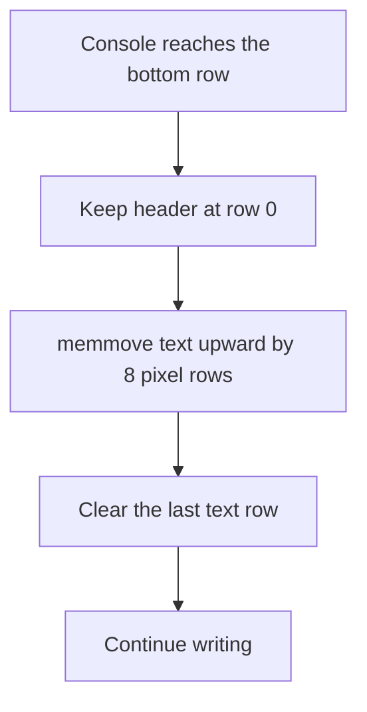
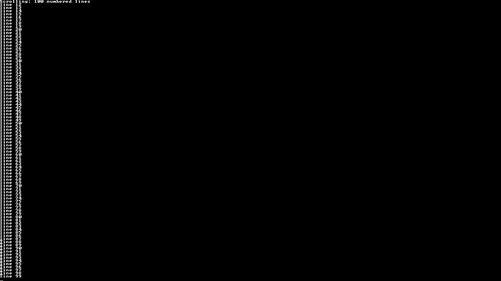

# 03 Scrolling

Move the framebuffer text area upward when the console reaches the bottom of
the screen. The first row is reserved for a header.

## Source files

| File | Role |
| --- | --- |
| [src/main.c](src/main.c) | Draws a header and prints 100 numbered lines |
| [src/console.c](src/console.c) | `traite_car` detects the bottom row; `defilement` moves the pixels |
| [src/string.c](src/string.c) | Supplied `memmove` and `memset` implementations |
| [src/font.c](src/font.c) | 8 × 8 character bitmaps |

## Moving one row



One character row occupies `8 * 1280` pixels. In `defilement`:

```c
uint32_t largeur_pixel = BITS * DISPLAY_WIDTH;
uint32_t *destination = (uint32_t *)ADRESSE_INITIAL + largeur_pixel;
uint32_t *source = (uint32_t *)ADRESSE_INITIAL + 2 * largeur_pixel;
uint32_t size = DISPLAY_WIDTH * (DISPLAY_HEIGHT - 2 * BITS) * sizeof(uint32_t);
memmove(destination, source, size);
```

`destination` starts at text row 1 and `source` at row 2. Copying upward replaces
row 1 with row 2, row 2 with row 3, and so on. The regions overlap, which is why
this operation uses `memmove`. `memset` then clears the final eight pixel rows.

```text
Before                After
row 0: header         row 0: header
row 1: oldest line    row 1: next line
row 2: next line      row 2: following line
...                   ...
last row: text        last row: empty
```

`main.c` prints lines 00–99. The serial terminal retains every line. The
framebuffer retains the most recent lines while the header stays in place.

## Build and run

From the repository root:

```sh
cd examples/03-scroll
sh scripts/course-env.sh make check
sh scripts/course-env.sh make
./run.sh
```

The scripts use the course tools at `/matieres/4MMPCSEA/xinul`: the RISC-V GCC
compiler and the custom QEMU with the CEP machine. The executable is
`build/cep/kernel.elf`. For another installation, set the directory explicitly:

```sh
COURSE_TOOLS=/path/to/xinul ./run.sh
```

To use Docker instead, run `./scripts/run-container.sh` in this folder.
It requires Linux x86_64, Docker, Xephyr, xauth and an X11 or XWayland desktop.
The Ubuntu/Debian packages are `docker.io`, `xserver-xephyr` and `xauth`.
Check `docker info`; the launcher obtains the course compiler/QEMU image on
first use. Both launch methods open the same activity. Close the window or
press Ctrl+C to stop.

To run without a window:

```sh
sh scripts/course-env.sh make run-serial
```

This still uses CEP; its graphics are offscreen. Exit with Ctrl+A, then X.
The normal QEMU installation does not include this course machine.

To save the serial output after building, use:

```sh
sh scripts/course-env.sh sh -c '
  "$QEMU" -machine cep -bios none -kernel build/cep/kernel.elf \
    -m 32M -smp 1 -display sdl -monitor none -serial file:build/uart.txt
'
```

The saved bytes are in `build/uart.txt`. The screenshots below show the CEP
framebuffer at 1280 × 720. Output was captured with the course GCC 11.1.0 and
QEMU 6.2.50 tools. All source and launch files needed by this activity are local
to this folder. [Attribution and licenses](../../README.md#credits).

## QEMU output



[Serial output](output/scroll.txt). At the end, the graphical text area shows
lines 12–99 and the last row is available for further output.
