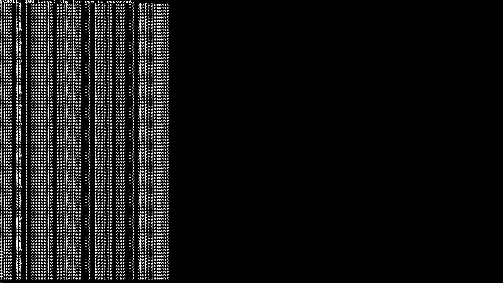

# 03 — Scrolling the framebuffer

Write 100 numbered lines into a console whose display has only 90 text rows. Keep a header in the reserved top row while older output scrolls away.

## Follow the code

1. Initialize the UART and console.
2. Write the header directly with `ecrit_car(0, column, character)`.
3. A single loop calls `printf` for lines `00` through `99`.
4. When the cursor reaches the bottom, `traite_car` calls `defilement`.
5. `defilement` moves framebuffer rows upward with `memmove` and clears the final eight pixel rows with `memset`.
6. Send `EVIDENCE: SCROLL PASS written=100 first_visible=12 last_visible=99` to UART and leave the screen visible.

The header remains at row 0. The first visible numbered line is `12`; the last is `99`. UART still contains all 100 lines because scrolling changes framebuffer memory, not bytes already transmitted.

Each text row is eight pixels high. The copy starts below the header and uses `memmove` because the source and destination regions overlap. Try lowering the loop bound below 88, then raise it again to observe when scrolling begins.

`printf.c` and `doprnt.c` provide the local formatted-output runtime; the example itself is the short loop in [src/main.c](src/main.c).

## Recorded output



[UART output](evidence/scroll.txt) · [Capture report](evidence/report.json)

## Run with Docker

On Linux x86_64 with an X11 or XWayland desktop, install Docker, Xephyr and xauth. On Ubuntu/Debian, the package names are `docker.io`, `xserver-xephyr` and `xauth`. Docker must be running and accessible to your user; check with `docker info`.

From this folder:

```sh
./scripts/run-container.sh
```

The script downloads a pinned image containing the RISC-V compiler and CEP QEMU, compiles this project, and opens a 1280 × 720 window. UART output appears in the terminal. Close the window or press Ctrl+C to stop. The script accepts no example selector: this folder is the whole example.

## Run with local CEP tools

The graphical device belongs to QEMU's **CEP** machine. Standard QEMU packages do not include it. With the compiler and CEP QEMU installed under `/matieres/4MMPCSEA/xinul`, run:

```sh
sh scripts/course-env.sh make check
sh scripts/course-env.sh make
./run.sh
```

For another installation directory:

```sh
COURSE_TOOLS=/path/to/xinul ./run.sh
```

With separately configured tools, use explicit overrides:

```sh
make CROSS_COMPILE=/path/to/bin/riscv64-unknown-elf- \
     QEMU=/path/to/qemu-system-riscv64 RISCV_ARCH=rv64ima run
```

GCC 11 bundled with CEP uses `rv64ima`; newer compilers can use the default `rv64ima_zicsr`. `make` builds `build/cep/kernel.elf`. `BUILD=build/custom` changes the output directory. `make run-serial` keeps the framebuffer offscreen and prints UART output in the terminal; exit with Ctrl+A, X. `make clean` removes the selected build directory.

## Files to read

| File | Purpose |
| --- | --- |
| [src/main.c](src/main.c) | The complete example, starting at `kernel_start` |
| [src/console.c](src/console.c) | Pixel writes, characters, cursor, control characters and scrolling |
| [src/font.c](src/font.c) | The 8 × 8 bitmap font |
| [src/uart.c](src/uart.c) | Polling output to the CEP UART |
| [src/crt0.S](src/crt0.S) | Set up the boot stack, clear BSS, call C |
| [src/kernel.lds](src/kernel.lds) | Place the ELF at CEP address `0x1000` |
| [src/string.c](src/string.c) | The memory/string routines this example uses |
| `Makefile` | Explicit local sources and fixed CEP build |

Every source, header, linker script and launcher needed by this example is inside this folder. You can copy the folder elsewhere and build it there. The only external requirements are the host tools or Docker image. Interrupts stay disabled; this static example has no clock, process table or scheduler.

## Credits

Source notices are retained in the local files. The font credits Daniel Hepper, Marcel Sondaar and IBM and declares public-domain terms. The small runtime includes code with its own notices; see the source headers and [COPYING.GPL-2](COPYING.GPL-2).
