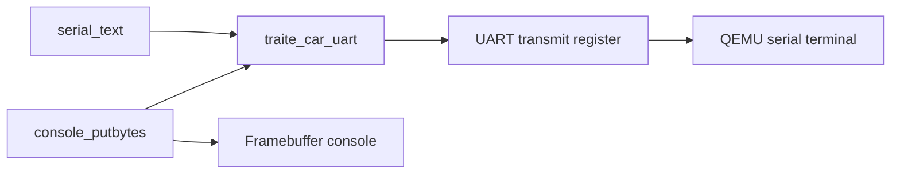
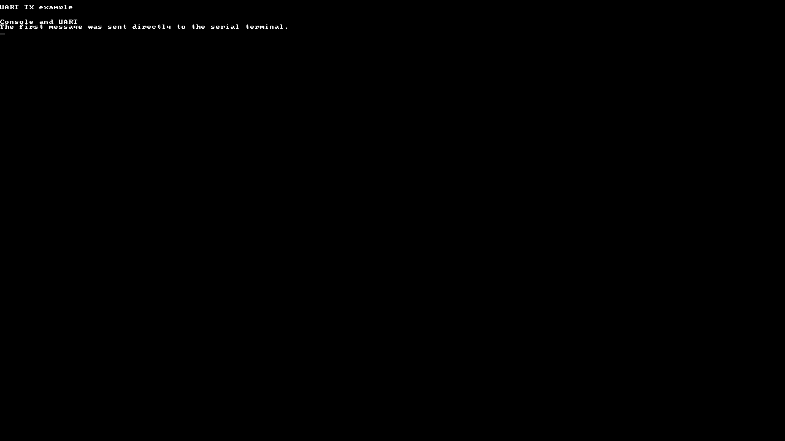

# 04 UART

Send characters through the CEP UART and compare direct serial output with
text written through the graphical console.

## Source files

| File | Role |
| --- | --- |
| [src/main.c](src/main.c) | Sends one message directly to UART and another through the console |
| [src/uart.c](src/uart.c) | Initializes the transmitter and writes bytes |
| [src/cep_platform.h](src/cep_platform.h) | UART clock, baud rate and register definitions |
| [src/console.c](src/console.c) | Mirrors console output to UART |

## Memory-mapped transmission



MMIO means memory-mapped I/O: the CPU accesses the peripheral through addresses
in its memory map. CEP exposes a SiFive-style UART at `0x10013000`. Its registers
are 32-bit words, so each index below advances four bytes.

| Access | Byte offset | Purpose |
| --- | --- | --- |
| `uart[0]` | `0x00` | Transmit a byte; bit 31 reports a full FIFO |
| `uart[2]` | `0x08` | Enable the transmitter |
| `uart[6]` | `0x18` | Set the baud-rate divider |

`init_uart` sets the divider for the configured 32 MHz clock and 115200 baud,
then enables transmission. Sending a character uses polling:

```c
while (uart[0] & 0x80000000U) { }
uart[0] = (uint8_t)c;
```

The loop waits until the transmit FIFO has space. The assignment submits the
byte. The pointer is `volatile` so the compiler performs the device accesses.
This activity implements transmission; it does not read keyboard input.

In `main.c`, `serial_text("UART only\n")` calls the driver directly. The next
message goes through `console_putbytes`, which writes both pixels and serial
bytes. The messages therefore have different destinations.

## Build and run

From the repository root:

```sh
cd examples/04-uart
sh scripts/course-env.sh make check
sh scripts/course-env.sh make
./run.sh
```

The scripts use the course tools at `/matieres/4MMPCSEA/xinul`: the RISC-V GCC
compiler and the custom QEMU with the CEP machine. The executable is
`build/cep/kernel.elf`. For another installation, set the directory explicitly:

```sh
COURSE_TOOLS=/path/to/xinul ./run.sh
```

To use Docker instead, run `./scripts/run-container.sh` in this folder.
It requires Linux x86_64, Docker, Xephyr, xauth and an X11 or XWayland desktop.
The Ubuntu/Debian packages are `docker.io`, `xserver-xephyr` and `xauth`.
Check `docker info`; the launcher obtains the course compiler/QEMU image on
first use. Both launch methods open the same activity. Close the window or
press Ctrl+C to stop.

To run without a window:

```sh
sh scripts/course-env.sh make run-serial
```

This still uses CEP; its graphics are offscreen. Exit with Ctrl+A, then X.
The normal QEMU installation does not include this course machine.

To save the serial output after building, use:

```sh
sh scripts/course-env.sh sh -c '
  "$QEMU" -machine cep -bios none -kernel build/cep/kernel.elf \
    -m 32M -smp 1 -display sdl -monitor none -serial file:build/uart.txt
'
```

The saved bytes are in `build/uart.txt`. The screenshots below show the CEP
framebuffer at 1280 × 720. Output was captured with the course GCC 11.1.0 and
QEMU 6.2.50 tools. All source and launch files needed by this activity are local
to this folder. [Attribution and licenses](../../README.md#credits).

## QEMU output



[Serial output](output/uart.txt). `UART only` appears in the terminal;
`Console and UART` appears in both the terminal and graphical window.
