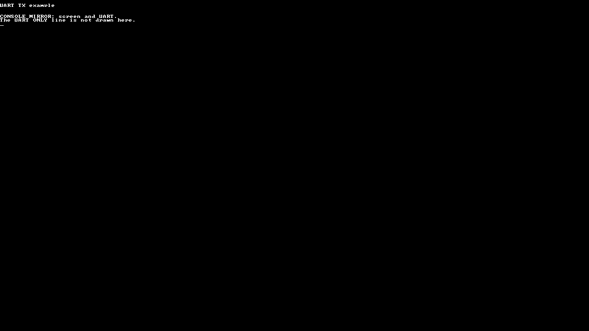
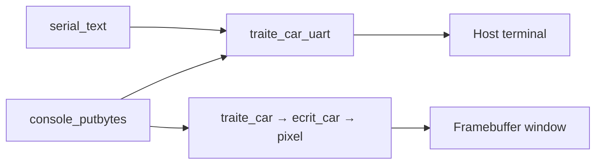

# 04 — UART output

A standalone CEP kernel that shows the difference between sending serial bytes and writing to the graphical console. Start reading at [src/main.c](src/main.c): it initializes UART, clears the screen, sends one message directly, then sends another through `console_putbytes`.

## Run this folder on its own

All source, headers, boot code, linker configuration and launch scripts are local. You can copy this entire directory elsewhere and run these commands from that copy.

For a Linux/amd64 desktop with Docker available, install the display helpers and start the fixed example:

```sh
sudo apt-get install -y xserver-xephyr xauth
./scripts/run-container.sh
```

The launcher downloads a pinned CEP toolchain image and opens an isolated Xephyr window. It requires an X11 or XWayland session. Close the window or press Ctrl+C to stop. If Docker is not installed, follow its [Ubuntu installation instructions](https://docs.docker.com/engine/install/ubuntu/).

With CEP tools installed locally:

```sh
./run.sh
```

The default tools directory is `/matieres/4MMPCSEA/xinul`. For another location:

```sh
COURSE_TOOLS=/path/to/xinul ./run.sh
```

That directory must contain `bin/riscv64-unknown-elf-gcc` and a `bin/qemu-system-riscv64` with the `cep` machine. Standard distribution QEMU does not include CEP.

Build and check without opening a window:

```sh
sh scripts/course-env.sh make check all
```

The executable is `build/cep/kernel.elf`. The Makefile also accepts `CROSS_COMPILE`, `QEMU`, `RISCV_ARCH`, `BUILD` and `OPT` overrides. For separately installed tools, use `make` directly; use `rv64ima` with GCC 11 or the default `rv64ima_zicsr` with modern toolchains.

```sh
make CROSS_COMPILE=/path/to/riscv64-unknown-elf- \
     QEMU=/path/to/qemu-system-riscv64 RISCV_ARCH=rv64ima BUILD=build/custom
```

`make run-serial` runs without a window; exit with Ctrl+A, then X. `make debug` starts paused for GDB on `localhost:1234`. Prefix either with `sh scripts/course-env.sh` when using the tool-directory wrapper.

## What to observe



Compare the [serial log](evidence/uart.txt) and [capture report](evidence/report.json) with the screen.

The terminal receives both lines:

```text
UART_ONLY: sent directly to UART.
CONSOLE_MIRROR: screen and UART.
```

The framebuffer contains the `CONSOLE_MIRROR` line. The `UART_ONLY` payload is sent directly to UART and does not appear as a line on screen. The explanatory sentence on screen names it so you can compare the two paths.



[uart.c](src/uart.c) accesses the SiFive UART at `0x10013000` through 32-bit registers. `init_uart` enables transmission and sets its divider. `traite_car_uart` waits while bit 31 of TX data indicates a full FIFO, then writes the byte. The register pointer is `volatile` so these device accesses are performed.

There is no timer, task table, scheduler or input driver in this folder. Interrupts stay disabled. After sending the messages, `kernel_start` stays in a `wfi` loop until QEMU is closed. UART reception and keyboard input are not implemented.

## Files to follow

| File | Role |
| --- | --- |
| [main.c](src/main.c) | Complete example in one linear startup function |
| [uart.c](src/uart.c), [uart.h](src/uart.h) | UART initialization and byte transmission |
| [console.c](src/console.c), [font.c](src/font.c) | Graphical text and the mirrored console path |
| [crt0.S](src/crt0.S), [kernel.lds](src/kernel.lds) | Boot stack, BSS clearing and ELF layout |
| [string.c](src/string.c) and local headers | Memory and string operations used by the console |

`EVIDENCE: UART PASS direct_tx=1 console_mirror=1` marks completion for a host capture tool. It is a capture marker, not an in-kernel framebuffer assertion. Compare the actual serial bytes and display to verify the result.

Support-source notices are retained in the local files. The referenced GPL text is included as [COPYING.GPL-2](COPYING.GPL-2).
