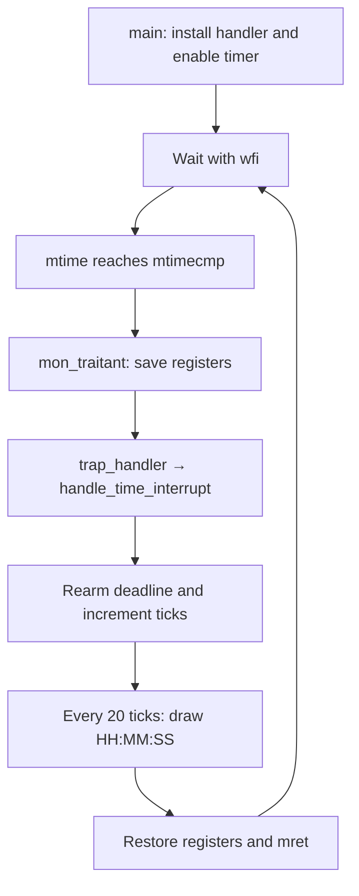

# 05 — Timer and clock

A standalone CEP kernel with timer interrupts and a clock in the top-right corner. [src/main.c](src/main.c) initializes UART and the console, installs the timer handler, enables interrupts, then prints each new second and waits with `wfi`.

There is **no process table, scheduler or context switch** in this example. The interrupted main loop resumes after every timer handler.

## Run this folder on its own

All source, headers, boot code, linker configuration and launch scripts are local. You can copy this entire directory elsewhere and run these commands from that copy.

For a Linux/amd64 desktop with Docker available, install the display helpers and start the fixed example:

```sh
sudo apt-get install -y xserver-xephyr xauth
./scripts/run-container.sh
```

The launcher downloads a pinned CEP toolchain image and opens an isolated Xephyr window. It requires an X11 or XWayland session. Close the window or press Ctrl+C to stop. If Docker is not installed, follow its [Ubuntu installation instructions](https://docs.docker.com/engine/install/ubuntu/).

With CEP tools installed locally:

```sh
./run.sh
```

The default tools directory is `/matieres/4MMPCSEA/xinul`. For another location:

```sh
COURSE_TOOLS=/path/to/xinul ./run.sh
```

That directory must contain `bin/riscv64-unknown-elf-gcc` and a `bin/qemu-system-riscv64` with the `cep` machine. Standard distribution QEMU does not include CEP.

Build and check without opening a window:

```sh
sh scripts/course-env.sh make check all
```

The executable is `build/cep/kernel.elf`. The Makefile also accepts `CROSS_COMPILE`, `QEMU`, `RISCV_ARCH`, `BUILD` and `OPT` overrides. For separately installed tools, use `make` directly; use `rv64ima` with GCC 11 or the default `rv64ima_zicsr` with modern toolchains.

```sh
make CROSS_COMPILE=/path/to/riscv64-unknown-elf- \
     QEMU=/path/to/qemu-system-riscv64 RISCV_ARCH=rv64ima BUILD=build/custom
```

`make run-serial` runs without a window; exit with Ctrl+A, then X. `make debug` starts paused for GDB on `localhost:1234`. Prefix either with `sh scripts/course-env.sh` when using the tool-directory wrapper.

## Follow one timer interrupt



[time.c](src/time.c) programs `mtimecmp` as the current `mtime` plus `TIMER_FREQ / ITFREQ`. The hardware counter is assumed to advance at **10 MHz**; `ITFREQ = 20` requests an interrupt every **500,000 counter increments**, nominally 50 ms. These values describe timer behavior, not CPU instruction frequency.

`init_traitant_timer` writes the assembly entry address into `mtvec`. `enable_timer` programs the deadline, enables the timer source in `mie`, then enables interrupts in `mstatus`. [traitant.S](src/traitant.S) saves 16 registers in a 128-byte stack frame before calling C, restores them afterward and executes `mret`.

The RV64 timer cause is `0x8000000000000007`. An unexpected cause prints `PANIC` and stops normal execution. Every handled timer interrupt increments `ticks`; `nbr_secondes()` returns `ticks / 20`. The display is updated once per second by `ecrit_car_en_haut` in [console.c](src/console.c).

## Expected output


The [serial log](evidence/clock.txt) and [capture report](evidence/report.json) accompany this screen.

The graphical clock progresses through `00:00:01`, `00:00:02`, `00:00:03` and continues. The ordinary console prints:

```text
clock=0s | timer interrupts=20 Hz
clock=1s | timer interrupts=20 Hz
clock=2s | timer interrupts=20 Hz
clock=3s | timer interrupts=20 Hz
```

UART also receives `EVIDENCE: CLOCK SECOND=0`, then 1, 2, 3 and later values. `EVIDENCE: CLOCK PASS` is emitted at second 3 as a host capture marker; the main loop does not assert register values or inspect the framebuffer.

This clock counts handled interrupts and rearms each deadline relative to the current counter. Delayed handling can make it fall behind elapsed hardware time; it is not a precision wall-clock measurement.

## Inspect registers

In terminal 1:

```sh
sh scripts/course-env.sh make debug
```

In terminal 2:

```sh
gdb-multiarch build/cep/kernel.elf
```

At the GDB prompt:

```gdb
target remote localhost:1234
break trap_handler
continue
print/x $mcause
print/x $mepc
print/x $mie
x/gx 0x0200bff8
x/gx 0x02004000
```

Expect the timer cause above and `mie` bit 7 set. The last two commands inspect `mtime` and `mtimecmp`. GDB pauses execution, so these reads explain state rather than establish timing accuracy.

## Local source map

- [main.c](src/main.c): the entire example's setup and wait loop.
- [time.c](src/time.c), [time.h](src/time.h), [traitant.S](src/traitant.S): timer setup, tick counting and trap handling.
- [console.c](src/console.c), [font.c](src/font.c), [uart.c](src/uart.c): graphical and serial output.
- [crt0.S](src/crt0.S), [kernel.lds](src/kernel.lds): boot and executable layout.
- Local formatting, string and header files: freestanding runtime support.

Support-source notices are retained in the local files. The referenced GPL text is included as [COPYING.GPL-2](COPYING.GPL-2).
