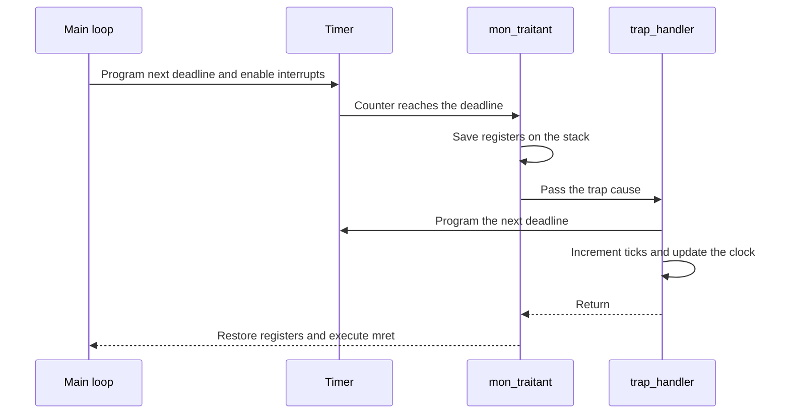
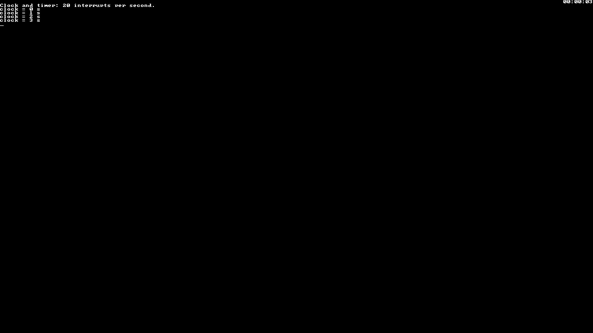

# 05 Timer interrupts

Configure periodic timer interrupts and display elapsed kernel time. This
activity runs one main loop; task scheduling is added in the next activity.

## Source files

| File | Role |
| --- | --- |
| [src/main.c](src/main.c) | Installs the handler and prints each new second |
| [src/time.c](src/time.c) | Programs the timer and counts interrupts |
| [src/time.h](src/time.h) | Interrupt frequency and CSR access macros |
| [src/traitant.S](src/traitant.S) | Saves registers before calling C and restores them before `mret` |
| [src/cpu.h](src/cpu.h) | Enables/disables interrupts and provides `wfi` |
| [src/cep_platform.h](src/cep_platform.h) | Timer addresses and frequency |

## Interrupt path



The platform's `mtime` counter advances at 10 MHz. `mtimecmp` stores the deadline
for the next interrupt. With `ITFREQ = 20`, the handler schedules it 500,000
counter increments ahead, a nominal interval of 50 ms:

```c
*((volatile uint64_t *)CLINT_TIMER_CMP) =
    *((volatile uint64_t *)CLINT_TIMER) + TIMER_FREQ / ITFREQ;
```

| Register | Purpose |
| --- | --- |
| `mtime` at `0x0200bff8` | Read the hardware time counter |
| `mtimecmp` at `0x02004000` | Set the next timer deadline |
| `mtvec` | Select the assembly trap entry point |
| `mie.MTIE` | Enable machine timer interrupts |
| `mstatus.MIE` | Enable interrupts globally |
| `mcause` | Identify the interrupt or exception |
| `mepc` | Hold the interrupted instruction address for resumption |

The first two registers use MMIO. The others are CPU control and status
registers, accessed by RISC-V instructions such as `csrr` and `csrw`.
`traitant.S` reserves 128 bytes on the current stack and saves `ra`, `a0..a7`
and `t0..t6` before calling C. `mret` returns from the trap.

`nbr_secondes()` divides the number of handled interrupts by 20. The top-right
clock changes once per kernel second. This count can lag behind wall time when
interrupt handling is delayed. The main loop uses `wfi` to wait between events.

## Build and run

From the repository root:

```sh
cd examples/05-clock
sh scripts/course-env.sh make check
sh scripts/course-env.sh make
./run.sh
```

The scripts use the course tools at `/matieres/4MMPCSEA/xinul`: the RISC-V GCC
compiler and the custom QEMU with the CEP machine. The executable is
`build/cep/kernel.elf`. For another installation, set the directory explicitly:

```sh
COURSE_TOOLS=/path/to/xinul ./run.sh
```

To use Docker instead, run `./scripts/run-container.sh` in this folder.
It requires Linux x86_64, Docker, Xephyr, xauth and an X11 or XWayland desktop.
The Ubuntu/Debian packages are `docker.io`, `xserver-xephyr` and `xauth`.
Check `docker info`; the launcher obtains the course compiler/QEMU image on
first use. Both launch methods open the same activity. Close the window or
press Ctrl+C to stop.

To run without a window:

```sh
sh scripts/course-env.sh make run-serial
```

This still uses CEP; its graphics are offscreen. Exit with Ctrl+A, then X.
The normal QEMU installation does not include this course machine.

To save the serial output after building, use:

```sh
sh scripts/course-env.sh sh -c '
  "$QEMU" -machine cep -bios none -kernel build/cep/kernel.elf \
    -m 32M -smp 1 -display sdl -monitor none -serial file:build/uart.txt
'
```

The saved bytes are in `build/uart.txt`. The screenshots below show the CEP
framebuffer at 1280 × 720. Output was captured with the course GCC 11.1.0 and
QEMU 6.2.50 tools. All source and launch files needed by this activity are local
to this folder. [Attribution and licenses](../../README.md#credits).

## QEMU output



[Serial output](output/clock.txt):

```text
Clock and timer: 20 interrupts per second.
clock = 0 s
clock = 1 s
clock = 2 s
clock = 3 s
```

The clock continues running. The image and log stop at the third second.
