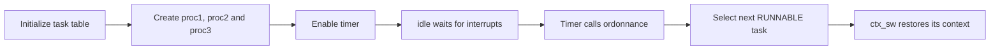
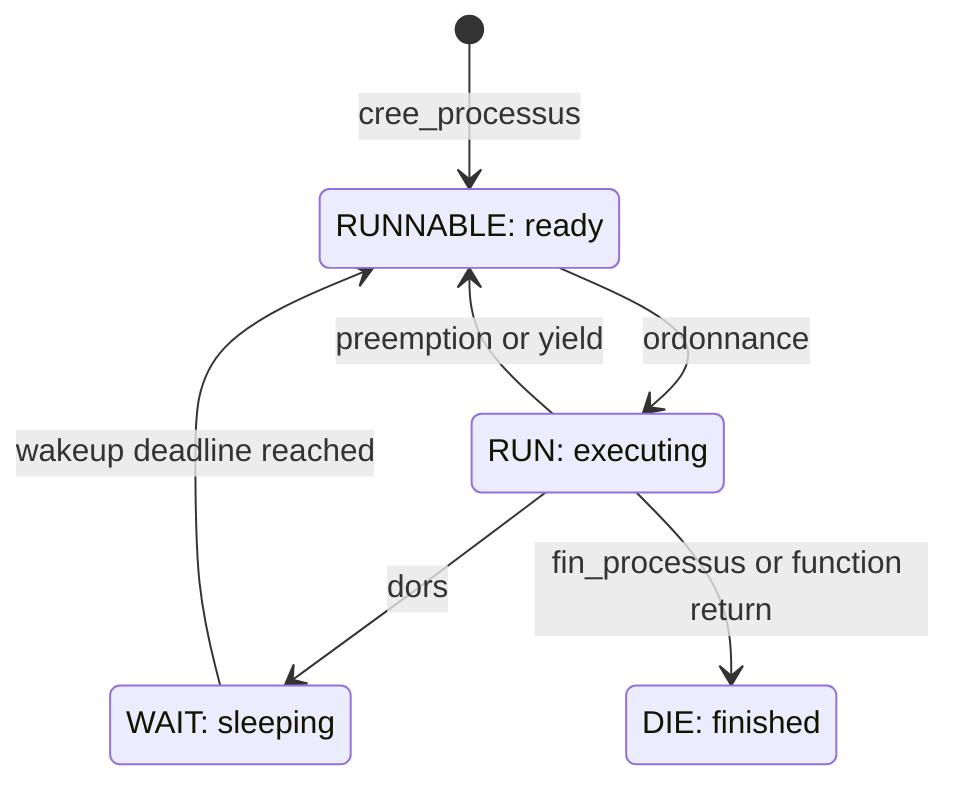

# 06 Processes

Run three C functions as kernel tasks, each with a saved context and a separate
stack. A timer-driven round-robin scheduler selects the next ready task.

## Source files

| File | Role |
| --- | --- |
| [src/main.c](src/main.c) | Initializes the kernel and defines `proc1`, `proc2`, `proc3` and `idle` |
| [src/processus.h](src/processus.h) | Task record, states and table size |
| [src/processus.c](src/processus.c) | Creation, scheduling, sleep, wakeup and termination |
| [src/ctxt.S](src/ctxt.S) | Saves and restores task contexts |
| [src/time.c](src/time.c), [src/traitant.S](src/traitant.S) | Timer interrupts and the interrupted register frame |
| [src/console.c](src/console.c), [src/uart.c](src/uart.c) | Display and transmit task events |

## Startup and task table

`kernel_start` initializes the console and task table while interrupts are
disabled. It installs the timer handler, creates the three tasks, enables the
timer and enters `idle`.



The four table entries hold a PID, name, state, saved registers, stack and
wakeup deadline. Three task stacks contain 4096 words of 64 bits: 32 KiB each.
`idle` continues on the boot stack. All tasks share kernel memory and machine
mode on one emulated CPU; they do not have separate address spaces.

## Round-robin and task states

`ordonnance` checks wakeup deadlines, then scans the table circularly from the
next PID. It selects a `RUNNABLE` entry and skips sleeping or terminated tasks.
`idle` participates in the same circular order and remains available.



`dors(n)` stores `nbr_secondes() + n`, marks the task `WAIT` and calls the
scheduler. The task becomes ready when its deadline is reached; it resumes
when selected. Deadlines use whole kernel seconds. `fin_processus` marks a task
`DIE` and schedules another. `proc_launcher` calls it automatically when a task
function returns. Finished table slots are not reused.

## Context switching

A stack is a region of RAM holding function-call data. The CPU's `sp` register
points into the stack currently in use. Each task retains its own stack in RAM.


The C scheduler passes the old and new register arrays to `ctx_sw` in `a0` and
`a1`. These instructions show the stack and return-address part of the switch:

```asm
sd ra, 0*8(a0)    # Save the old return address.
sd sp, 1*8(a0)    # Save the old stack pointer.
# Save the remaining context, then restore the next context.
ld ra, 0*8(a1)    # Load the next return address.
ld sp, 1*8(a1)    # Select the next stack.
# Restore the remaining registers before ret.
```

The full routine also saves/restores `gp`, `tp`, `s0..s11`, `mepc` and `mstatus`.
An interrupt has a separate frame for argument and temporary registers in
`traitant.S`. Table updates and the switch run with interrupts disabled.
Saving a stack pointer is sufficient to find the existing stack again; the
stack contents are not copied during each switch.

## Task bodies

Each task prints its identity and kernel time, sleeps, repeats once, and exits.

| Task | Sleep per iteration | Exit |
| --- | --- | --- |
| `proc1` | 2 seconds | Returns through `proc_launcher` |
| `proc2` | 3 seconds | Calls `fin_processus` |
| `proc3` | 4 seconds | Returns through `proc_launcher` |

`idle` prints its identity once and waits with `wfi`. The clock continues after
the other tasks have finished. Sleep yields voluntarily; timer interrupts also
invoke the scheduler between these calls.

## Build and run

From the repository root:

```sh
cd examples/06-processes
sh scripts/course-env.sh make check
sh scripts/course-env.sh make
./run.sh
```

The scripts use the course tools at `/matieres/4MMPCSEA/xinul`: the RISC-V GCC
compiler and the custom QEMU with the CEP machine. The executable is
`build/cep/kernel.elf`. For another installation, set the directory explicitly:

```sh
COURSE_TOOLS=/path/to/xinul ./run.sh
```

To use Docker instead, run `./scripts/run-container.sh` in this folder.
It requires Linux x86_64, Docker, Xephyr, xauth and an X11 or XWayland desktop.
The Ubuntu/Debian packages are `docker.io`, `xserver-xephyr` and `xauth`.
Check `docker info`; the launcher obtains the course compiler/QEMU image on
first use. Both launch methods open the same activity. Close the window or
press Ctrl+C to stop.

To run without a window:

```sh
sh scripts/course-env.sh make run-serial
```

This still uses CEP; its graphics are offscreen. Exit with Ctrl+A, then X.
The normal QEMU installation does not include this course machine.

To save the serial output after building, use:

```sh
sh scripts/course-env.sh sh -c '
  "$QEMU" -machine cep -bios none -kernel build/cep/kernel.elf \
    -m 32M -smp 1 -display sdl -monitor none -serial file:build/uart.txt
'
```

The saved bytes are in `build/uart.txt`. The screenshots below show the CEP
framebuffer at 1280 × 720. Output was captured with the course GCC 11.1.0 and
QEMU 6.2.50 tools. All source and launch files needed by this activity are local
to this folder. [Attribution and licenses](../../README.md#credits).

## QEMU output


[Serial output](output/processes.txt) contains task creation, sleep, wakeup and
exit messages. The state panel uses `0 = RUN`, `1 = RUNNABLE`, `2 = WAIT` and
`3 = DIE`. Near the beginning it shows idle running with three waiting tasks;
after completion it shows `[0 3 3 3]`. The panel refreshes once per second and
may lag behind the latest serial event.

The screenshots were captured near kernel seconds 1 and 9. Event times and
interleaving can vary slightly between runs.
